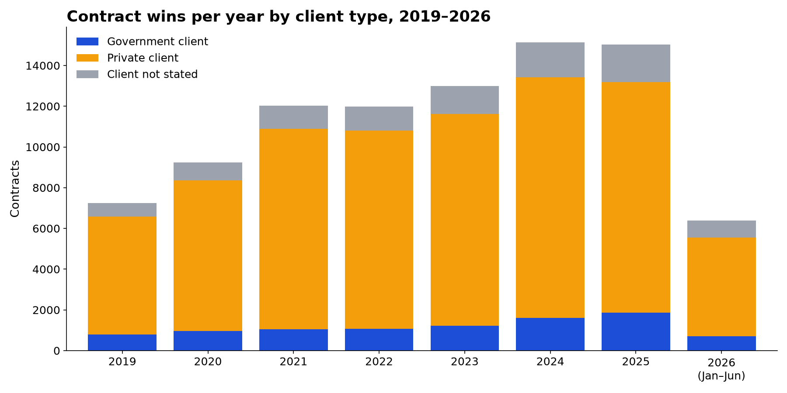
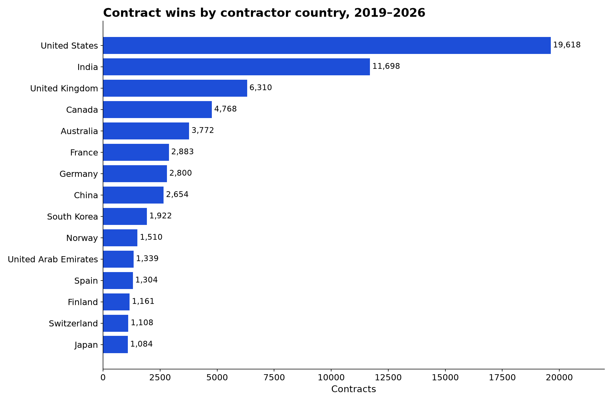
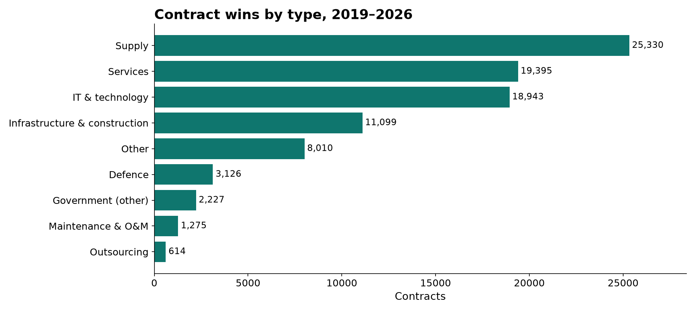

# Contract Wins Dataset 2019–2026: Orders & Tenders: findings, method and data card

> Contract wins dataset: 90,019 company contracts and orders worldwide, 2019 to June 2026, with client, contract value, government and defence deals.

*Fliar Research · released October 2026 · licence CC BY-NC 4.0*

**How this dataset was acquired.** Every row comes from the [Radar API](https://github.com/fliarbi/radar-api-mcp), Fliar's company-data API and MCP server. Radar reads
business news and company announcements continuously, picks out sentences that report a contract win, an order or a tender award, and
extracts the contractor, the client, the value and currency, and the scope. Each party is linked to its website in a database of five
million companies, which adds country, sector and headquarters location. Repeated reports of one contract are merged into a single row,
clients that are people are excluded, clients are classed as government or private from their name, and every value is checked against
the figure in the news sentence. This release covers January 2019 to June 2026 worldwide, with dedicated tables for the United States,
the United Kingdom and India. The full, continuously updated event timeline for any company is served by `POST /v1/companies/events`
([reference](https://github.com/fliarbi/radar-api-mcp/blob/main/docs/reference/get_company_events.md)) and the `get_company_events` MCP tool.

> **This file is a 25% sample: 22,576 of 90,019 contracts.** It keeps every record for a fixed subset of contractors.
> The subset is chosen by a hash, so it stays the same from one release to the next. The findings and tables below were computed
> on the **full** data. For the rest, the withheld fields and monthly updates, [get a Radar API key](https://fliarbi.com/radar-api/developer) ([docs](https://github.com/fliarbi/radar-api-mcp)).
> Each row's `fliar_profile_url` opens the company's full profile on Fliar.

## Key findings

1. **90,019 contract wins and orders by 41,030 companies, January 2019 to June 2026.** 88% name the client organisation.
2. **Contract announcements rose from 7,244 in 2019 to 15,023 in 2025**; 2026 has 6,387 in its first half.
3. **Government is the client in 12% of contracts with a known client type.** Defence accounts for 3,126 contracts, infrastructure and construction 11,099, IT and technology 18,943.
4. **20,660 contracts (23%) disclose a value**, together $9.4T; the median is $36.0M. The largest is Boeing for Air India ($100.0B, 2023).
5. **The most frequent winner is Boeing** with 332 contracts, followed by Larsen Toubro (306) and Airbus (302).
6. **By contractor country:** United States 19,618, India 11,698, United Kingdom 6,310, Canada 4,768, Australia 3,772 contracts; 48% of contracts with a known country go to companies in the top three.

### Contract wins by year

2026 covers January to June.

| Year      | Contracts   | Companies   | Government client   | Private client   | Defence   | With value   | Disclosed value   | Median value   |
|:----------|:------------|:------------|:--------------------|:-----------------|:----------|:-------------|:------------------|:---------------|
| 2019      | 7,244       | 4,928       | 797                 | 5,794            | 323       | 1,436        | $974.8B           | $60.0M         |
| 2020      | 9,229       | 6,240       | 954                 | 7,416            | 321       | 1,823        | $694.0B           | $48.0M         |
| 2021      | 12,028      | 7,855       | 1,051               | 9,849            | 403       | 2,349        | $950.0B           | $38.0M         |
| 2022      | 11,991      | 7,846       | 1,063               | 9,742            | 364       | 2,250        | $1.0T             | $50.0M         |
| 2023      | 12,987      | 8,494       | 1,218               | 10,409           | 429       | 2,820        | $1.7T             | $49.0M         |
| 2024      | 15,130      | 9,446       | 1,609               | 11,812           | 449       | 3,814        | $1.4T             | $32.4M         |
| 2025      | 15,023      | 9,138       | 1,865               | 11,330           | 599       | 4,524        | $2.0T             | $20.7M         |
| 2026 (H1) | 6,387       | 4,608       | 698                 | 4,850            | 238       | 1,644        | $632.3B           | $36.4M         |

### Top 50 largest contracts worldwide, 2019–2026

Disclosed values only, checked against the news sentence. Multi-year framework values are reported as announced.

| #   | Date       | Contractor                             | Country        | Client                                                                   | Client type   | Contract type                 | Value (US$)   | Sector                          |
|:----|:-----------|:---------------------------------------|:---------------|:-------------------------------------------------------------------------|:--------------|:------------------------------|:--------------|:--------------------------------|
| 1   | 2023-02-09 | Boeing                                 | United States  | Air India                                                                | private       | Supply                        | $100.0B       | Aerospace, Maritime and Defense |
| 2   | 2023-02-10 | Airbus                                 | France         | Air India                                                                | private       | Supply                        | $100.0B       | Aerospace, Maritime and Defense |
| 3   | 2025-10-06 | AMD                                    | United States  | OpenAI                                                                   | private       | Supply                        | $90.0B        | Semiconductors                  |
| 4   | 2019-04-15 | KBRwyle                                | United States  | U.S. Army                                                                | government    | Defence                       | $82.0B        | Defense                         |
| 5   | 2023-11-20 | ECS                                    | United States  | Department of Veterans Affairs (VA) Office of Information and Technology | government    | Government (other)            | $60.7B        | Retail                          |
| 6   | 2023-11-12 | Boeing                                 | United States  | Emirates                                                                 | private       | Supply                        | $52.0B        | Aerospace, Maritime and Defense |
| 7   | 2025-08-25 | Boeing                                 | United States  | Korean Air                                                               | private       | Supply                        | $50.0B        | Aerospace, Maritime and Defense |
| 8   | 2023-05-09 | Boeing                                 | United States  | Ryanair                                                                  | private       | Supply                        | $40.0B        | Aerospace, Maritime and Defense |
| 9   | 2025-11-03 | Amazon                                 | United States  | OpenAI                                                                   | private       | IT & technology               | $38.0B        | Retail                          |
| 10  | 2025-11-17 | Boeing                                 | United States  | Emirates                                                                 | private       | Supply                        | $38.0B        | Aerospace, Maritime and Defense |
| 11  | 2023-03-14 | Boeing                                 | United States  | SAUDIA                                                                   | government    | Supply                        | $37.0B        | Aerospace, Maritime and Defense |
| 12  | 2022-07-01 | Airbus                                 | France         | Air China; China Eastern; China Southern; Shenzhen Airlines              | private       | Supply                        | $37.0B        | Aerospace, Maritime and Defense |
| 13  | 2024-12-19 | Boeing                                 | United States  | Pegasus                                                                  | private       | Supply                        | $36.0B        | Aerospace, Maritime and Defense |
| 14  | 2019-03-25 | Airbus                                 | France         | CADC                                                                     | government    | Supply                        | $35.0B        | Aerospace, Maritime and Defense |
| 15  | 2025-08-07 | NewMed Energy                          | Israel         | Egypt’s Blue Ocean Energy                                                | government    | Supply                        | $35.0B        | Energy                          |
| 16  | 2021-11-14 | Airbus                                 | France         | Indigo Partners                                                          | private       | Supply                        | $33.0B        | Aerospace, Maritime and Defense |
| 17  | 2023-01-30 | Posco Chemical                         | South Korea    | Samsung SDI                                                              | private       | Supply                        | $32.6B        | Chemicals and Materials         |
| 18  | 2019-03-26 | Airbus                                 | France         | China Aviation Supplies Holding Company                                  | private       | Supply                        | $32.4B        | Aerospace, Maritime and Defense |
| 19  | 2023-07-13 | International Brotherhood of Teamsters | United States  | UPS                                                                      | private       | Other                         | $30.0B        |                                 |
| 20  | 2024-06-14 | PanTeXas Deterrence LLC                | United States  | U.S. Department of Energy – National Nuclear Security Administration     | government    | Defence                       | $30.0B        | Defense                         |
| 21  | 2019-10-29 | Airbus                                 | France         | Indigo                                                                   | private       | Supply                        | $30.0B        | Aerospace, Maritime and Defense |
| 22  | 2022-06-12 | Shell                                  | United Kingdom | Qatarenergy                                                              | private       | Infrastructure & construction | $30.0B        | Energy                          |
| 23  | 2021-06-29 | Boeing & Airbus                        | United States  | United Airlines                                                          | private       | Supply                        | $30.0B        | Aviation                        |
| 24  | 2026-03-16 | Nebius                                 | Netherlands    | Meta                                                                     | private       | Infrastructure & construction | $27.0B        | Enterprise Infrastructure       |
| 25  | 2024-07-02 | Airbus                                 | France         | Cebu Pacific Air                                                         | private       | Supply                        | $25.2B        | Aerospace, Maritime and Defense |
| 26  | 2019-06-18 | Boeing                                 | United States  | IAG                                                                      | private       | Supply                        | $24.0B        | Aerospace, Maritime and Defense |
| 27  | 2025-11-18 | Airbus                                 | France         | Flydubai                                                                 | private       | Supply                        | $24.0B        | Aerospace, Maritime and Defense |
| 28  | 2023-04-26 | POSCO Future M                         | South Korea    | LG Energy Solution                                                       | private       | Supply                        | $23.0B        | Chemicals and Materials         |
| 29  | 2026-04-09 | CoreWeave                              | United States  | Meta                                                                     | private       | IT & technology               | $21.0B        | High Tech                       |
| 30  | 2023-04-18 | Foxconn                                | Taiwan         | Vedanta                                                                  | private       | Other                         | $20.0B        | Semiconductors                  |
| 31  | 2024-01-02 | Boeing                                 | United States  | Akasa Air                                                                | private       | Supply                        | $20.0B        | Aerospace, Maritime and Defense |
| 32  | 2019-05-30 | CFM                                    | United States  | Indigo                                                                   | private       | Supply                        | $20.0B        | Aerospace, Maritime and Defense |
| 33  | 2021-02-04 | MicroTech                              | United States  | U.S. Federal Government                                                  | government    | Government (other)            | $20.0B        | Business Services               |
| 34  | 2024-02-06 | Lgchem                                 | South Korea    | General Motors                                                           | private       | Supply                        | $19.0B        | Chemicals and Materials         |
| 35  | 2025-09-08 | Nebius Group                           | Netherlands    | Microsoft                                                                | private       | IT & technology               | $17.4B        | Technology                      |
| 36  | 2025-07-28 | Samsung                                | South Korea    | Tesla                                                                    | private       | Supply                        | $16.5B        | Consumer Goods                  |
| 37  | 2025-07-28 | Samsung                                | South Korea    | Tesla                                                                    | private       | Supply                        | $16.5B        | Consumer Goods                  |
| 38  | 2026-03-25 | Airbus                                 | France         | China Eastern Airlines                                                   | private       | Supply                        | $15.8B        | Aerospace, Maritime and Defense |
| 39  | 2020-07-05 | Volkswagen                             | Germany        | U.S. government and State of California                                  | government    | Government (other)            | $15.3B        | Auto                            |
| 40  | 2022-07-17 | Boeing                                 | United States  | Delta                                                                    | private       | Supply                        | $15.0B        | Aerospace, Maritime and Defense |
| 41  | 2019-12-05 | Saab AB                                | Sweden         | India                                                                    | government    | Defence                       | $15.0B        | Defence                         |
| 42  | 2022-09-13 | Xinte Energy                           | China          | Jinko Solar                                                              | private       | Supply                        | $14.3B        | Energy                          |
| 43  | 2023-03-30 | Petrofac                               | United Kingdom | TenneT                                                                   | private       | Supply                        | $14.0B        | Business Services               |
| 44  | 2019-11-18 | Airbus                                 | France         | Air Arabia PJSC                                                          | private       | Supply                        | $14.0B        | Aerospace, Maritime and Defense |
| 45  | 2023-12-05 | Ericsson                               | Sweden         | AT&T                                                                     | private       | IT & technology               | $14.0B        | Telecom                         |
| 46  | 2021-03-14 | Northvolt                              | Sweden         | Volkswagen Group                                                         | private       | Supply                        | $14.0B        | Energy Tech                     |
| 47  | 2024-03-18 | Airbus                                 | France         | Korean Air                                                               | private       | Supply                        | $14.0B        | Aerospace, Maritime and Defense |
| 48  | 2025-09-30 | CoreWeave                              | United States  | Meta                                                                     | private       | Infrastructure & construction | $14.0B        | High Tech                       |
| 49  | 2025-08-25 | GE Aerospace                           | United States  | Korean Air                                                               | private       | Maintenance & O&M             | $13.7B        | Aerospace, Maritime and Defense |
| 50  | 2024-08-07 | Airbus                                 | France         | Cathay                                                                   | private       | Supply                        | $13.0B        | Aerospace, Maritime and Defense |

### Companies with the most contract wins (top 50)

| #   | Company                      | Country        | Sector                             | Contract wins   | From government   | With value   | Disclosed value   | Main contract type            | 2025 wins   |
|:----|:-----------------------------|:---------------|:-----------------------------------|:----------------|:------------------|:-------------|:------------------|:------------------------------|:------------|
| 1   | Boeing                       | United States  | Aerospace, Maritime and Defense    | 332             | 65                | 102          | $627.5B           | Supply                        | 49          |
| 2   | Larsen Toubro                | India          | Conglomerates                      | 306             | 97                | 35           | $48.6B            | Infrastructure & construction | 49          |
| 3   | Airbus                       | France         | Aerospace, Maritime and Defense    | 302             | 15                | 71           | $624.0B           | Supply                        | 46          |
| 4   | Vestas                       | Denmark        | Energy                             | 172             | 2                 | 1            | $1.0B             | Supply                        | 21          |
| 5   | Siemens                      | Germany        | Industrial Goods and Manufacturing | 151             | 34                | 38           | $37.6B            | Supply                        | 15          |
| 6   | TCS                          | India          | Business Services                  | 142             | 15                | 23           | $29.7B            | IT & technology               | 23          |
| 7   | Amazon Web Services          | United States  | Hospitality / Cloud                | 138             | 16                | 20           | $8.0B             | IT & technology               | 15          |
| 8   | Wärtsilä                     | Finland        | Energy                             | 136             | 3                 | 2            | $369.0M           | Supply                        | 20          |
| 9   | Nordex Group                 | Germany        | Wind Energy                        | 135             | 10                | 0            | $0                | Supply                        | 32          |
| 10  | Nokia                        | Finland        | Telecom                            | 127             | 3                 | 10           | $15.5B            | IT & technology               | 25          |
| 11  | Samsung Heavy Industries     | South Korea    | Energy                             | 123             | 4                 | 69           | $89.7B            | Supply                        | 17          |
| 12  | Andritz Group                | Austria        | Energy                             | 123             | 1                 | 4            | $1.3B             | Supply                        | 26          |
| 13  | Embraer                      | Brazil         | Aerospace, Maritime and Defense    | 118             | 13                | 32           | $48.1B            | Supply                        | 17          |
| 14  | Oracle                       | United States  | Enterprise Infrastructure          | 116             | 14                | 11           | $10.9B            | IT & technology               | 17          |
| 15  | TotalEnergies                | France         | Energy                             | 115             | 31                | 14           | $27.0B            | Supply                        | 25          |
| 16  | Kec International            | India          | Transmission And Distribution      | 115             | 28                | 46           | $7.0B             | Infrastructure & construction | 28          |
| 17  | ABB                          | Switzerland    | Industrial Goods and Manufacturing | 112             | 3                 | 13           | $9.5B             | IT & technology               | 17          |
| 18  | Kalmar                       | Finland        | Transportation and Logistics       | 112             | 2                 | 3            | $55.2M            | Supply                        | 9           |
| 19  | Microsoft                    | United States  | Enterprise Infrastructure          | 111             | 16                | 21           | $40.2B            | IT & technology               | 17          |
| 20  | Konecranes                   | Finland        | Port Operations                    | 106             | 5                 | 6            | $329.2M           | Supply                        | 11          |
| 21  | IBM                          | United States  | Enterprise Infrastructure          | 105             | 23                | 40           | $15.3B            | IT & technology               | 10          |
| 22  | Valmet                       | Finland        | Industrial Goods and Manufacturing | 104             | 0                 | 4            | $485.8M           | Supply                        | 13          |
| 23  | Infor                        | United States  | Enterprise Applications            | 103             | 2                 | 3            | $4.8B             | IT & technology               | 0           |
| 24  | Ericsson                     | Sweden         | Telecom                            | 100             | 2                 | 9            | $29.5B            | IT & technology               | 10          |
| 25  | Google                       | United States  | High Tech                          | 98              | 12                | 21           | $14.3B            | IT & technology               | 18          |
| 26  | Saipem                       | Italy          | Real Estate and Construction       | 96              | 1                 | 44           | $62.4B            | Services                      | 19          |
| 27  | KBR                          | United States  | Energy                             | 95              | 14                | 13           | $6.8B             | IT & technology               | 10          |
| 28  | Valaris                      | Bermuda        | Energy                             | 90              | 0                 | 40           | $5.6B             | Services                      | 10          |
| 29  | RailTel Corporation of India | India          | Telecom                            | 86              | 51                | 78           | $798.8M           | IT & technology               | 36          |
| 30  | Alstom                       | France         | Travel and Hospitality             | 82              | 24                | 54           | $46.6B            | Supply                        | 16          |
| 31  | Accenture                    | United States  | Investment Industry                | 82              | 21                | 25           | $10.1B            | IT & technology               | 9           |
| 32  | Infosys                      | India          | Business Services                  | 80              | 2                 | 23           | $26.0B            | IT & technology               | 12          |
| 33  | Baker Hughes                 | United States  | Marine Logistics                   | 80              | 0                 | 4            | $7.6B             | Supply                        | 13          |
| 34  | Metso Outotec                | Finland        | Mining                             | 80              | 0                 | 34           | $1.8B             | Supply                        | 0           |
| 35  | Borr Drilling                | Norway         | Energy                             | 78              | 0                 | 17           | $2.1B             | Services                      | 11          |
| 36  | L&T                          | India          | Construction / Real Estate         | 77              | 31                | 11           | $12.7B            | Infrastructure & construction | 12          |
| 37  | Worley                       | Australia      | Energy                             | 77              | 1                 | 2            | $140.9M           | Services                      | 5           |
| 38  | Tata Motors                  | India          | Auto                               | 75              | 12                | 7            | $4.6B             | Supply                        | 3           |
| 39  | Nordex                       | Germany        | Energy                             | 72              | 12                | 2            | $401.8M           | Supply                        | 13          |
| 40  | Bharat Electronics           | India          | Defense                            | 70              | 42                | 53           | $16.7B            | Defence                       | 19          |
| 41  | ST Engineering               | Singapore      | Aerospace, Maritime and Defense    | 70              | 9                 | 10           | $6.8B             | Maintenance & O&M             | 14          |
| 42  | Amazon                       | United States  | Retail                             | 69              | 7                 | 11           | $57.3B            | Services                      | 12          |
| 43  | Shell                        | United Kingdom | Energy                             | 68              | 13                | 5            | $33.1B            | Supply                        | 7           |
| 44  | Palantir                     | United States  | Enterprise Applications            | 68              | 31                | 35           | $9.7B             | IT & technology               | 16          |
| 45  | Capgemini                    | France         | Business Services                  | 67              | 5                 | 10           | $4.0B             | IT & technology               | 12          |
| 46  | GE Aerospace                 | United States  | Aerospace, Maritime and Defense    | 66              | 11                | 5            | $20.1B            | Supply                        | 23          |
| 47  | NBCC                         | India          | Real Estate and Construction       | 66              | 26                | 59           | $8.2B             | Infrastructure & construction | 18          |
| 48  | HCL Technologies             | India          | Business Services                  | 66              | 1                 | 7            | $5.3B             | IT & technology               | 14          |
| 49  | Guidewire                    | United States  | Fintech                            | 66              | 1                 | 1            | $17.0M            | IT & technology               | 4           |
| 50  | Wood                         | United Kingdom | Energy                             | 65              | 3                 | 21           | $3.9B             | Services                      | 10          |

### Government vs private clients by contract type

Government covers ministries, agencies, public bodies, state-owned companies and armed forces, recognised from the client name.

| Contract type                 | Contracts   | Government client   | Private client   | Client not stated   | With value   | Disclosed value   | Median value   | 2025   |
|:------------------------------|:------------|:--------------------|:-----------------|:--------------------|:-------------|:------------------|:---------------|:-------|
| Defence                       | 3,126       | 2,422               | 704              | 0                   | 1,764        | $946.6B           | $65.8M         | 599    |
| Infrastructure & construction | 11,099      | 1,538               | 7,989            | 1,572               | 3,765        | $1.7T             | $72.0M         | 2,114  |
| IT & technology               | 18,943      | 1,078               | 16,543           | 1,322               | 2,539        | $956.5B           | $17.0M         | 2,685  |
| Supply                        | 25,330      | 1,399               | 20,573           | 3,358               | 5,736        | $3.3T             | $29.1M         | 4,541  |
| Services                      | 19,395      | 983                 | 16,495           | 1,917               | 3,787        | $863.4B           | $19.3M         | 3,001  |
| Maintenance & O&M             | 1,275       | 109                 | 1,047            | 119                 | 318          | $82.6B            | $35.6M         | 227    |
| Outsourcing                   | 614         | 26                  | 540              | 48                  | 78           | $33.2B            | $101.3M        | 97     |
| Government (other)            | 2,227       | 1,476               | 751              | 0                   | 718          | $524.1B           | $71.0M         | 438    |
| Other                         | 8,010       | 224                 | 6,560            | 1,226               | 1,955        | $1.0T             | $42.5M         | 1,321  |

### Government buyers awarding the most contracts (top 40)

Client names as reported; one body can appear under several spellings.

| #   | Government client                                | Country        | Contracts   | Contractors   | Disclosed value   | Main contract type            | Most frequent contractors                                                                         |
|:----|:-------------------------------------------------|:---------------|:------------|:--------------|:------------------|:------------------------------|:--------------------------------------------------------------------------------------------------|
| 1   | America's Navy                                   | United States  | 129         | 104           | $91.6B            | Defence                       | Boeing, Raytheon, Ingalls Shipbuilding                                                            |
| 2   | U.S. Army                                        | United States  | 119         | 99            | $101.7B           | Defence                       | Palantir, Boeing, KBR                                                                             |
| 3   | U.S. Air Force                                   | United States  | 114         | 94            | $28.9B            | Defence                       | Boeing, Accenture, Raytheon Technologies                                                          |
| 4   | Ministry of Defence                              | India          | 111         | 80            | $39.0B            | Defence                       | Bharat Electronics, Beml Limited, Hindustan Aeronautics                                           |
| 5   | DLA                                              | United States  | 101         | 79            | $18.5B            | Defence                       | Noble, SupplyCore, Husky Marketing & Supply                                                       |
| 6   | Indian Railways                                  | India          | 87          | 67            | $18.9B            | Supply                        | Kec International, Bharat Heavy Electricals, Siemens                                              |
| 7   | NTPC                                             | India          | 76          | 64            | $14.0B            | Supply                        | Bharat Heavy Electricals, GE Power India, Tata Power Solar                                        |
| 8   | Department of Defense                            | United States  | 76          | 66            | $33.1B            | Defence                       | Carahsoft, LMI, HII                                                                               |
| 9   | General Services Administration                  | United States  | 64          | 63            | $4.0B             | Government (other)            | IBM, iGov, Quadrint                                                                               |
| 10  | Indian Oil                                       | India          | 63          | 58            | $8.9B             | Supply                        | McDermott International, Tecnimont ICB, Nuberg EPC                                                |
| 11  | Defense.gov                                      | United States  | 62          | 57            | $15.6B            | Defence                       | Prattwhitney, Booz Allen, MP Materials                                                            |
| 12  | Solar Energy Corporation of India                | India          | 56          | 48            | $4.6B             | Supply                        | Adani Green Energy, Engie, ReNew Solar Power Pvt.                                                 |
| 13  | Nnsa Energy                                      | United States  | 47          | 44            | $31.1B            | Government (other)            | Accenture, Central Plateau Cleanup Company LLC, BWX Technologies                                  |
| 14  | NASA                                             | United States  | 46          | 37            | $14.5B            | Services                      | Leidos, Intuitive Machines, Sierra Nevada Corp                                                    |
| 15  | Air Force                                        | United States  | 44          | 41            | $20.4B            | Defence                       | Boeing, Gulfstream, Intelligent Waves                                                             |
| 16  | U.S. Army Corps Of Engineers                     | United States  | 42          | 42            | $2.7B             | Defence                       | Leidos, CJW Construction, Callanmarineltd                                                         |
| 17  | Saudi Arabia                                     | Saudi Arabia   | 41          | 37            | $23.3B            | Infrastructure & construction | Kec International, Larsen Toubro, L&T                                                             |
| 18  | United States                                    | United States  | 41          | 40            | $17.4B            | Supply                        | Welspun indian limited, GE Medical Systems Information Technologies, Steel Strips Wheels Ltd SSWL |
| 19  | Department Of Energy                             | United States  | 38          | 38            | $29.0B            | Services                      | Siemens, AECOM, Washington River Protection Solutions                                             |
| 20  | India                                            | India          | 37          | 35            | $45.1B            | Supply                        | Kec International, Hindustan Aeronautics, Saab AB                                                 |
| 21  | National Highways Authority of India             | India          | 36          | 28            | $4.5B             | Infrastructure & construction | HG Infra, IRB Infrastructure Developers, GR Infraprojects                                         |
| 22  | Indian Oil Corporation                           | India          | 31          | 30            | $234.1M           | Supply                        | Agarwal Industrial, L&T Hydrocarbon Engineering, ADNOC                                            |
| 23  | SJVN                                             | India          | 30          | 26            | $1.6B             | Supply                        | Reliance NU Energies, M/s Solarworld Energy Solutions Private Limited, ACME Solar                 |
| 24  | Indian Army                                      | India          | 30          | 26            | $6.7B             | Defence                       | Bharat Dynamics, ideaForge, Bharat Electronics                                                    |
| 25  | National Geospatial-Intelligence Agency          | United States  | 29          | 24            | $2.7B             | Services                      | BlackSky, General Dynamics Information Technology, BAE Systems                                    |
| 26  | Indian Air Force                                 | India          | 28          | 17            | $32.7B            | Defence                       | Hindustan Aeronautics, Tata Advanced Systems, Saab                                                |
| 27  | U.S. Air Force Life Cycle Management Center      | United States  | 27          | 27            | $40.0M            | Defence                       | A&T Systems, AIS, AdelaTech                                                                       |
| 28  | ONGC                                             | India          | 26          | 24            | $1.4B             | Services                      | Vantage Drilling, Mazagon Dock Shipbuilders, C.E. Thornton                                        |
| 29  | Network Rail                                     | United Kingdom | 26          | 26            | $5.9B             | Maintenance & O&M             | Bam Nuttall & Farrans, Bamnuttall, QTS                                                            |
| 30  | GAIL                                             | India          | 26          | 26            | $78.2M            | Supply                        | Bharat Heavy Electricals, Total SA Ltd, Surya Roshni                                              |
| 31  | Australian Government                            | Australia      | 25          | 22            | $6.3B             | Government (other)            | Mckinsey, IBM, Petrofac                                                                           |
| 32  | Federal Aviation Administration                  | United States  | 25          | 23            | $11.8B            | Services                      | Science Applications International, Parsons, Alaska Airlines                                      |
| 33  | Coal India                                       | India          | 25          | 24            | $2.9B             | Supply                        | Belaz, Projects & Development India, Legal Consultant                                             |
| 34  | Government of Canada                             | Canada         | 25          | 25            | $13.8B            | Government (other)            | Amazon Canada, Atco Frontec, GSK                                                                  |
| 35  | Mumbai Metropolitan Region Development Authority | India          | 25          | 23            | $10.2B            | Infrastructure & construction | Bharat Earth Movers, J Kumar Infraprojects, Bombardier                                            |
| 36  | Department of Defence                            | Australia      | 24          | 22            | $2.9B             | Defence                       | Telstra, IBM, Blacktree                                                                           |
| 37  | Government of Ghana                              | Ghana          | 24          | 23            | $2.8B             | Government (other)            | Ethiopian Airlines, Sinohydro, Power Distribution Services                                        |
| 38  | Uttarakhand Government                           | India          | 23          | 23            | $0                | Other                         | AD Mehta Logistics, Amul, Arya Ocean Logistics Park                                               |
| 39  | U.S. Department of Health and Human Services     | United States  | 23          | 21            | $3.4B             | Supply                        | SIGA Technologies, Emergent BioSolutions, DuPont                                                  |
| 40  | Digital Transformation Agency                    | Australia      | 23          | 16            | $2.8B             | IT & technology               | Amazon Web Services, DELV, Deloitte                                                               |

### Contract wins by contractor country (top 40)

| Country              | Contracts   | Companies   | Government share   | With value   | Disclosed value   | Median value   | 2025   | Most frequent winners                                                             |
|:---------------------|:------------|:------------|:-------------------|:-------------|:------------------|:---------------|:-------|:----------------------------------------------------------------------------------|
| United States        | 19,618      | 7,894       | 12.6%              | 3,643        | $3.0T             | $68.0M         | 2,695  | Boeing, Amazon Web Services, Oracle                                               |
| India                | 11,698      | 3,820       | 21.7%              | 4,712        | $973.8B           | $21.6M         | 3,237  | Larsen Toubro, TCS, Kec International                                             |
| United Kingdom       | 6,310       | 3,130       | 7.6%               | 1,233        | $389.9B           | $20.6M         | 905    | Shell, Wood, Petrofac                                                             |
| Canada               | 4,768       | 2,155       | 5.4%               | 1,351        | $174.2B           | $3.9M          | 755    | NexTech AR Solutions, Red Cloud, CGI                                              |
| Australia            | 3,772       | 1,524       | 6.9%               | 1,233        | $228.4B           | $21.3M         | 453    | Worley, Monadelphous, Thiess                                                      |
| France               | 2,883       | 799         | 7.5%               | 483          | $854.3B           | $120.7M        | 493    | Airbus, TotalEnergies, Alstom                                                     |
| Germany              | 2,800       | 1,013       | 7.4%               | 325          | $181.4B           | $63.5M         | 441    | Siemens, Nordex Group, Nordex                                                     |
| China                | 2,654       | 1,211       | 5.7%               | 568          | $270.5B           | $127.2M        | 484    | BYD, Huawei, Yangzijiang Shipbuilding                                             |
| South Korea          | 1,922       | 531         | 7.0%               | 701          | $792.2B           | $390.0M        | 357    | Samsung Heavy Industries, HD Hyundai Heavy Industries, Samsung                    |
| Norway               | 1,510       | 428         | 2.2%               | 362          | $64.4B            | $37.7M         | 215    | Borr Drilling, Aker Solutions, Hexagon Purus                                      |
| United Arab Emirates | 1,339       | 601         | 12.9%              | 283          | $200.9B           | $102.0M        | 253    | ADNOC, DP World, AD Ports Group                                                   |
| Spain                | 1,304       | 562         | 6.8%               | 257          | $165.4B           | $162.0M        | 149    | Siemens Gamesa, Iberdrola, Amadeus                                                |
| Finland              | 1,161       | 190         | 2.5%               | 135          | $25.7B            | $25.9M         | 135    | Nokia, Wärtsilä, Kalmar                                                           |
| Switzerland          | 1,108       | 358         | 4.5%               | 193          | $94.8B            | $111.0M        | 155    | ABB, Transocean, Temenos                                                          |
| Japan                | 1,084       | 443         | 5.5%               | 109          | $59.3B            | $102.0M        | 160    | Mitsui OSK Lines, Kawasaki Heavy Industries, Mitsubishi Power Americas            |
| Sweden               | 1,067       | 375         | 5.9%               | 310          | $102.9B           | $22.4M         | 132    | Ericsson, Epiroc, Sandvik                                                         |
| Singapore            | 1,049       | 532         | 5.3%               | 210          | $91.9B            | $61.4M         | 136    | ST Engineering, BOC Aviation, Seatrium                                            |
| Malaysia             | 936         | 555         | 7.3%               | 227          | $42.0B            | $28.3M         | 187    | PETRONAS, Yinson, Sapura Energy                                                   |
| Denmark              | 811         | 188         | 3.5%               | 113          | $19.5B            | $47.9M         | 93     | Vestas, Haldor Topsoe, FLSmidth                                                   |
| Netherlands          | 806         | 364         | 4.6%               | 70           | $106.9B           | $237.6M        | 82     | Fugro, Wolters Kluwer, CEVA Logistics                                             |
| Italy                | 797         | 345         | 7.7%               | 163          | $130.9B           | $324.0M        | 123    | Saipem, Eni Next, Tecnimont ICB                                                   |
| Brazil               | 767         | 396         | 8.7%               | 197          | $117.7B           | $200.0M        | 127    | Embraer, Petrobras, Vale                                                          |
| Israel               | 710         | 293         | 12.3%              | 197          | $67.7B            | $8.3M          | 64     | Sapiens, Elbit Systems, SuperCom                                                  |
| Saudi Arabia         | 464         | 280         | 9.3%               | 145          | $124.3B           | $135.0M        | 93     | Saudi Aramco, ACWA Power, Aramco                                                  |
| Ireland              | 448         | 217         | 2.2%               | 86           | $22.5B            | $6.8M          | 66     | CDB Aviation, AerCap, Avolon                                                      |
| Nigeria              | 411         | 254         | 13.1%              | 62           | $33.1B            | $51.8M         | 101    | NNPC, Nigerian Aviation Handling Company Plc, NNPC Ltd                            |
| Austria              | 352         | 128         | 4.3%               | 58           | $14.2B            | $30.2M         | 69     | Andritz Group, Steyr Motors, Wolftank Group                                       |
| South Africa         | 289         | 212         | 9.7%               | 41           | $6.0B             | $14.2M         | 38     | MiX Telematics, Afreximbank, De Beers Diamond Jewellers                           |
| Oman                 | 275         | 160         | 6.5%               | 46           | $2.4B             | $29.5M         | 47     | Oman LNG, Galfar, Oman Telecommunications Company                                 |
| Turkey               | 251         | 155         | 15.1%              | 60           | $26.3B            | $124.1M        | 82     | ASELSAN, Turkishtechnic, Çelebi                                                   |
| Belgium              | 226         | 132         | 4.4%               | 13           | $3.0B             | $101.0M        | 36     | Umicore, NHV, Jandenul                                                            |
| Pakistan             | 205         | 139         | 11.7%              | 20           | $6.1B             | $18.5M         | 46     | Symmetry Group, Pakistan Telecommunication, Supernet                              |
| Taiwan               | 204         | 111         | 9.3%               | 34           | $57.5B            | $162.5M        | 38     | Foxconn, Gong cha, Hon Hai Technology Group                                       |
| Russia               | 195         | 117         | 14.9%              | 23           | $22.7B            | $150.0M        | 12     | Gazprom, NOVATEK, United Wagon Company                                            |
| Bangladesh           | 191         | 108         | 1.6%               | 9            | $1.5B             | $29.7M         | 26     | Prime Bank, Eastern Bank, BRAC Bank                                               |
| Bermuda              | 191         | 38          | 1.0%               | 76           | $23.0B            | $87.4M         | 22     | Valaris, Seadrill, Enstar Group                                                   |
| Philippines          | 168         | 128         | 11.9%              | 27           | $11.2B            | $27.0M         | 26     | First Gen, Asian Development Bank, ACEN Renewable Energy Solutions                |
| New Zealand          | 168         | 108         | 8.9%               | 31           | $7.0B             | $26.0M         | 12     | Scott Technology, East Imperial, Datacom                                          |
| Hong Kong            | 154         | 128         | 7.8%               | 39           | $10.8B            | $62.7M         | 24     | Gammon, Gammon Construction, HAECO Hong Kong                                      |
| Indonesia            | 150         | 136         | 8.7%               | 28           | $10.3B            | $35.8M         | 21     | PT Vale Indonesia Tbk, PT Bukit Makmur Mandiri Utama, Garuda Maintenance Facility |

### Contract wins by contractor country and year (top 30)

| Country              | 2019   | 2020   | 2021   | 2022   | 2023   | 2024   | 2025   | 2026 (H1)   | Total   |
|:---------------------|:-------|:-------|:-------|:-------|:-------|:-------|:-------|:------------|:--------|
| United States        | 1,900  | 2,166  | 2,793  | 2,839  | 2,896  | 3,147  | 2,695  | 1,182       | 19,618  |
| India                | 720    | 709    | 986    | 1,173  | 1,521  | 2,398  | 3,237  | 954         | 11,698  |
| United Kingdom       | 565    | 804    | 1,015  | 875    | 785    | 968    | 905    | 393         | 6,310   |
| Canada               | 334    | 506    | 731    | 661    | 681    | 807    | 755    | 293         | 4,768   |
| Australia            | 442    | 544    | 629    | 571    | 528    | 448    | 453    | 157         | 3,772   |
| France               | 245    | 244    | 340    | 388    | 446    | 513    | 493    | 214         | 2,883   |
| Germany              | 249    | 317    | 369    | 380    | 376    | 428    | 441    | 240         | 2,800   |
| China                | 167    | 261    | 334    | 306    | 404    | 468    | 484    | 230         | 2,654   |
| South Korea          | 81     | 156    | 204    | 240    | 336    | 383    | 357    | 165         | 1,922   |
| Norway               | 56     | 176    | 242    | 254    | 238    | 240    | 215    | 89          | 1,510   |
| United Arab Emirates | 80     | 124    | 171    | 189    | 230    | 205    | 253    | 87          | 1,339   |
| Spain                | 136    | 162    | 198    | 188    | 193    | 189    | 149    | 89          | 1,304   |
| Finland              | 101    | 147    | 225    | 175    | 157    | 151    | 135    | 70          | 1,161   |
| Switzerland          | 100    | 144    | 160    | 169    | 139    | 177    | 155    | 64          | 1,108   |
| Japan                | 75     | 111    | 139    | 156    | 193    | 182    | 160    | 68          | 1,084   |
| Sweden               | 99     | 159    | 130    | 157    | 169    | 158    | 132    | 63          | 1,067   |
| Singapore            | 99     | 104    | 137    | 124    | 171    | 190    | 136    | 88          | 1,049   |
| Malaysia             | 13     | 43     | 68     | 50     | 108    | 278    | 187    | 189         | 936     |
| Denmark              | 52     | 100    | 138    | 114    | 137    | 132    | 93     | 45          | 811     |
| Netherlands          | 78     | 107    | 163    | 118    | 100    | 101    | 82     | 57          | 806     |
| Italy                | 61     | 92     | 114    | 98     | 114    | 128    | 123    | 67          | 797     |
| Brazil               | 54     | 54     | 123    | 126    | 134    | 105    | 127    | 44          | 767     |
| Israel               | 37     | 67     | 109    | 120    | 129    | 137    | 64     | 47          | 710     |
| Saudi Arabia         | 15     | 25     | 44     | 68     | 101    | 76     | 93     | 42          | 464     |
| Ireland              | 49     | 45     | 66     | 69     | 73     | 58     | 66     | 22          | 448     |
| Nigeria              | 40     | 36     | 52     | 42     | 50     | 66     | 101    | 24          | 411     |
| Austria              | 24     | 30     | 43     | 38     | 52     | 60     | 69     | 36          | 352     |
| South Africa         | 35     | 32     | 45     | 44     | 41     | 35     | 38     | 19          | 289     |
| Oman                 | 19     | 27     | 36     | 55     | 52     | 24     | 47     | 15          | 275     |
| Turkey               | 10     | 19     | 27     | 22     | 40     | 37     | 82     | 14          | 251     |

### Contract wins by sector (top 30)

| Sector                             | Contracts   | Companies   | Government share   | With value   | Disclosed value   | Median value   | 2025   | Most frequent winners                                    |
|:-----------------------------------|:------------|:------------|:-------------------|:-------------|:------------------|:---------------|:-------|:---------------------------------------------------------|
| Energy                             | 9,367       | 2,907       | 9.2%               | 1,922        | $1.1T             | $65.6M         | 1,656  | Vestas, Andritz Group, Samsung Heavy Industries          |
| Business Services                  | 5,572       | 2,391       | 14.4%              | 1,174        | $354.6B           | $27.6M         | 835    | TCS, Infosys, Capgemini                                  |
| Mining                             | 3,006       | 1,617       | 4.4%               | 976          | $158.3B           | $25.0M         | 437    | Metso, Thiess, Epiroc                                    |
| Real Estate and Construction       | 2,818       | 1,053       | 13.4%              | 1,163        | $343.9B           | $67.8M         | 497    | Saipem, NBCC, Monadelphous                               |
| Enterprise Applications            | 2,782       | 1,126       | 6.3%               | 334          | $75.6B            | $6.3M          | 325    | Infor, Palantir, IFS                                     |
| Aerospace, Maritime and Defense    | 2,730       | 384         | 23.5%              | 905          | $1.8T             | $243.0M        | 458    | Boeing, Airbus, Embraer                                  |
| Fintech                            | 2,327       | 993         | 4.9%               | 207          | $53.5B            | $9.6M          | 277    | Guidewire, Sapiens, Temenos                              |
| Financial Services                 | 2,296       | 1,130       | 5.5%               | 549          | $243.1B           | $30.0M         | 343    | Cognizant, Deloitte, Independent Trading Group           |
| Energy Tech                        | 2,061       | 632         | 5.9%               | 417          | $150.2B           | $17.3M         | 305    | BYD, TechnipFMC, Aker Solutions                          |
| Telecom                            | 1,837       | 513         | 13.6%              | 527          | $177.3B           | $19.8M         | 330    | Nokia, Ericsson, RailTel Corporation of India            |
| High Tech                          | 1,770       | 669         | 13.2%              | 425          | $191.5B           | $6.7M          | 320    | Google, NexTech AR Solutions, Nvidia                     |
| Industrial Goods and Manufacturing | 1,748       | 639         | 9.6%               | 411          | $128.5B           | $22.0M         | 334    | Siemens, ABB, Valmet                                     |
| Transportation and Logistics       | 1,662       | 532         | 8.1%               | 255          | $116.4B           | $86.4M         | 244    | Kalmar, AD Ports Group, DP World                         |
| Healthcare                         | 1,524       | 963         | 9.7%               | 397          | $131.5B           | $33.0M         | 247    | Samsung BioLogics, Pfizer, ASCO                          |
| Retail                             | 1,514       | 849         | 4.0%               | 200          | $189.9B           | $18.6M         | 208    | Amazon, RELEX, Dematic                                   |
| Auto                               | 1,422       | 470         | 8.6%               | 267          | $122.1B           | $48.0M         | 220    | Tata Motors, SRG Global, General Motors                  |
| Travel and Hospitality             | 1,349       | 438         | 10.4%              | 245          | $147.5B           | $105.8M        | 250    | Alstom, Menzies Aviation, CDB Aviation                   |
| Enterprise Infrastructure          | 1,311       | 420         | 10.9%              | 237          | $175.6B           | $25.4M         | 202    | Oracle, Microsoft, IBM                                   |
| Consumer                           | 1,308       | 583         | 7.5%               | 147          | $50.3B            | $29.2M         | 194    | GXO, Sabre, GTT                                          |
| Food and Agriculture               | 1,113       | 700         | 6.5%               | 178          | $54.3B            | $21.9M         | 188    | Bubs, PepsiCo, Cargill                                   |
| Chemicals and Materials            | 1,029       | 365         | 6.9%               | 231          | $209.3B           | $60.0M         | 170    | Haldor Topsoe, Glencore, Air Liquide                     |
| Renewable Energy                   | 990         | 706         | 12.1%              | 202          | $54.3B            | $31.5M         | 231    | Nordex Group, Lightsource BP, Ge Renewable Energy        |
| Consumer Goods                     | 978         | 434         | 9.1%               | 222          | $105.7B           | $22.5M         | 162    | Honeywell, Samsung, Wipro Consumer Care                  |
| Infrastructure                     | 954         | 726         | 30.1%              | 497          | $145.1B           | $33.9M         | 235    | Kec International, NBCC (India) Ltd, Rpp Infra Projects  |
| Environment                        | 897         | 353         | 13.5%              | 254          | $59.4B            | $19.4M         | 166    | Wabag, Qatarenergy, Mitsubishi Power Americas            |
| Technology                         | 834         | 691         | 8.2%               | 178          | $63.8B            | $15.0M         | 126    | Amazon Web Services, Datable Technology, Td Synnex       |
| Conglomerates                      | 814         | 167         | 19.7%              | 166          | $121.3B           | $202.0M        | 124    | Larsen Toubro, General Electric, Tata Group              |
| Defense                            | 805         | 529         | 70.3%              | 486          | $323.0B           | $54.2M         | 154    | Bharat Electronics, Hindustan Aeronautics, Aerovironment |
| Life Sciences                      | 797         | 506         | 10.4%              | 263          | $51.2B            | $20.0M         | 102    | Emergent BioSolutions, Aptamer Group, SIGA Technologies  |
| Media & Entertainment              | 752         | 367         | 3.6%               | 71           | $48.3B            | $100.0M        | 102    | Engie, Mcdermott, Gaming Innovation Group                |

### Top 50 largest contracts won by US companies, 2019–2026

| #   | Date       | Contractor                             | Country       | Client                                                                   | Client type   | Contract type                 | Value (US$)   | Sector                               |
|:----|:-----------|:---------------------------------------|:--------------|:-------------------------------------------------------------------------|:--------------|:------------------------------|:--------------|:-------------------------------------|
| 1   | 2023-02-09 | Boeing                                 | United States | Air India                                                                | private       | Supply                        | $100.0B       | Aerospace, Maritime and Defense      |
| 2   | 2025-10-06 | AMD                                    | United States | OpenAI                                                                   | private       | Supply                        | $90.0B        | Semiconductors                       |
| 3   | 2019-04-15 | KBRwyle                                | United States | U.S. Army                                                                | government    | Defence                       | $82.0B        | Defense                              |
| 4   | 2023-11-20 | ECS                                    | United States | Department of Veterans Affairs (VA) Office of Information and Technology | government    | Government (other)            | $60.7B        | Retail                               |
| 5   | 2023-11-12 | Boeing                                 | United States | Emirates                                                                 | private       | Supply                        | $52.0B        | Aerospace, Maritime and Defense      |
| 6   | 2025-08-25 | Boeing                                 | United States | Korean Air                                                               | private       | Supply                        | $50.0B        | Aerospace, Maritime and Defense      |
| 7   | 2023-05-09 | Boeing                                 | United States | Ryanair                                                                  | private       | Supply                        | $40.0B        | Aerospace, Maritime and Defense      |
| 8   | 2025-11-17 | Boeing                                 | United States | Emirates                                                                 | private       | Supply                        | $38.0B        | Aerospace, Maritime and Defense      |
| 9   | 2025-11-03 | Amazon                                 | United States | OpenAI                                                                   | private       | IT & technology               | $38.0B        | Retail                               |
| 10  | 2023-03-14 | Boeing                                 | United States | SAUDIA                                                                   | government    | Supply                        | $37.0B        | Aerospace, Maritime and Defense      |
| 11  | 2024-12-19 | Boeing                                 | United States | Pegasus                                                                  | private       | Supply                        | $36.0B        | Aerospace, Maritime and Defense      |
| 12  | 2024-06-14 | PanTeXas Deterrence LLC                | United States | U.S. Department of Energy – National Nuclear Security Administration     | government    | Defence                       | $30.0B        | Defense                              |
| 13  | 2023-07-13 | International Brotherhood of Teamsters | United States | UPS                                                                      | private       | Other                         | $30.0B        |                                      |
| 14  | 2021-06-29 | Boeing & Airbus                        | United States | United Airlines                                                          | private       | Supply                        | $30.0B        | Aviation                             |
| 15  | 2019-06-18 | Boeing                                 | United States | IAG                                                                      | private       | Supply                        | $24.0B        | Aerospace, Maritime and Defense      |
| 16  | 2026-04-09 | CoreWeave                              | United States | Meta                                                                     | private       | IT & technology               | $21.0B        | High Tech                            |
| 17  | 2019-05-30 | CFM                                    | United States | Indigo                                                                   | private       | Supply                        | $20.0B        | Aerospace, Maritime and Defense      |
| 18  | 2024-01-02 | Boeing                                 | United States | Akasa Air                                                                | private       | Supply                        | $20.0B        | Aerospace, Maritime and Defense      |
| 19  | 2021-02-04 | MicroTech                              | United States | U.S. Federal Government                                                  | government    | Government (other)            | $20.0B        | Business Services                    |
| 20  | 2022-07-17 | Boeing                                 | United States | Delta                                                                    | private       | Supply                        | $15.0B        | Aerospace, Maritime and Defense      |
| 21  | 2025-09-30 | CoreWeave                              | United States | Meta                                                                     | private       | Infrastructure & construction | $14.0B        | High Tech                            |
| 22  | 2025-08-25 | GE Aerospace                           | United States | Korean Air                                                               | private       | Maintenance & O&M             | $13.7B        | Aerospace, Maritime and Defense      |
| 23  | 2021-03-10 | MicroTech                              | United States | Dia                                                                      | government    | Defence                       | $12.6B        | Business Services                    |
| 24  | 2024-08-20 | Telos                                  | United States | Department of the Air Force                                              | government    | Defence                       | $12.5B        | Enterprise Infrastructure            |
| 25  | 2025-03-10 | CoreWeave                              | United States | OpenAI                                                                   | private       | IT & technology               | $12.0B        | High Tech                            |
| 26  | 2019-06-17 | Air Lease Corporation                  | United States | Airbus                                                                   | private       | Supply                        | $11.0B        | Transportation and Logistics         |
| 27  | 2025-08-14 | Global Infrastructure Partners         | United States | Aramco                                                                   | private       | Infrastructure & construction | $11.0B        | Natural Gas Infrastructure           |
| 28  | 2022-10-20 | Bechtel Energy                         | United States | Sempra Infrastructure                                                    | private       | Infrastructure & construction | $10.5B        | Energy                               |
| 29  | 2019-10-25 | Microsoft                              | United States | Pentagon                                                                 | government    | Defence                       | $10.0B        | Enterprise Infrastructure            |
| 30  | 2026-03-13 | Cerebras Systems                       | United States | OpenAI                                                                   | private       | Supply                        | $10.0B        | Semiconductors                       |
| 31  | 2025-08-10 | Google                                 | United States | Meta                                                                     | private       | IT & technology               | $10.0B        | High Tech                            |
| 32  | 2025-10-24 | Parsons                                | United States | America's Navy                                                           | government    | Defence                       | $10.0B        | Telecom                              |
| 33  | 2025-05-09 | Boeing                                 | United States | IAG                                                                      | government    | Government (other)            | $10.0B        | Aerospace, Maritime and Defense      |
| 34  | 2020-09-17 | Central Plateau Cleanup Company LLC    | United States | Nnsa Energy                                                              | government    | Services                      | $10.0B        | Nuclear                              |
| 35  | 2025-09-05 | Broadcom                               | United States | OpenAI                                                                   | private       | Supply                        | $10.0B        | Enterprise Infrastructure            |
| 36  | 2023-11-12 | Honeywell Aerospace                    | United States |                                                                          | not stated    | IT & technology               | $10.0B        | Aerospace, Maritime and Defense Tech |
| 37  | 2021-08-30 | Newport News Shipbuilding              | United States | America's Navy                                                           | government    | Defence                       | $9.8B         | Aerospace, Maritime and Defense      |
| 38  | 2025-11-03 | IREN Limited                           | United States | Microsoft                                                                | private       | IT & technology               | $9.7B         | Ai Infrastructure                    |
| 39  | 2025-08-14 | TeraWulf                               | United States | FluidStack                                                               | private       | Infrastructure & construction | $9.5B         | High Tech                            |
| 40  | 2025-01-21 | Boeing                                 | United States | Etihad Airways                                                           | private       | Supply                        | $9.4B         | Aerospace, Maritime and Defense      |
| 41  | 2020-07-21 | eBay Inc                               | United States | Adevinta                                                                 | private       | IT & technology               | $9.2B         | Online Classifieds                   |
| 42  | 2019-11-30 | Fiat Chrysler                          | United States | UAW                                                                      | private       | Services                      | $9.0B         | Automotive                           |
| 43  | 2021-11-16 | Boeing                                 | United States | Akasa Air                                                                | private       | Supply                        | $9.0B         | Aerospace, Maritime and Defense      |
| 44  | 2019-08-12 | AON                                    | United States | HSBC                                                                     | private       | Services                      | $8.9B         | Healthcare                           |
| 45  | 2019-11-20 | Boeing                                 | United States | Emirates                                                                 | private       | Supply                        | $8.8B         | Aerospace, Maritime and Defense      |
| 46  | 2023-09-07 | Ford                                   | United States | UA Works                                                                 | private       | Other                         | $8.8B         | Auto                                 |
| 47  | 2025-09-23 | Boeing                                 | United States | Uzbekistan Ministry of Transport                                         | government    | Supply                        | $8.5B         | Aerospace, Maritime and Defense      |
| 48  | 2022-08-09 | Delfin Midstream                       | United States | Centrica                                                                 | private       | Supply                        | $8.5B         | Energy                               |
| 49  | 2022-03-17 | MGM                                    | United States | Amazon                                                                   | private       | Other                         | $8.5B         | Consumer Goods                       |
| 50  | 2021-05-13 | Zachry Group & KBR Joint Venture       | United States | Venture Global LNG                                                       | private       | Infrastructure & construction | $8.5B         | Energy                               |

### US companies with the most contract wins (top 50)

| #   | Company                    | Country       | Sector                          | Contract wins   | From government   | With value   | Disclosed value   | Main contract type            | 2025 wins   |
|:----|:---------------------------|:--------------|:--------------------------------|:----------------|:------------------|:-------------|:------------------|:------------------------------|:------------|
| 1   | Boeing                     | United States | Aerospace, Maritime and Defense | 332             | 65                | 102          | $627.5B           | Supply                        | 49          |
| 2   | Amazon Web Services        | United States | Hospitality / Cloud             | 138             | 16                | 20           | $8.0B             | IT & technology               | 15          |
| 3   | Oracle                     | United States | Enterprise Infrastructure       | 116             | 14                | 11           | $10.9B            | IT & technology               | 17          |
| 4   | Microsoft                  | United States | Enterprise Infrastructure       | 111             | 16                | 21           | $40.2B            | IT & technology               | 17          |
| 5   | IBM                        | United States | Enterprise Infrastructure       | 105             | 23                | 40           | $15.3B            | IT & technology               | 10          |
| 6   | Infor                      | United States | Enterprise Applications         | 103             | 2                 | 3            | $4.8B             | IT & technology               | 0           |
| 7   | Google                     | United States | High Tech                       | 98              | 12                | 21           | $14.3B            | IT & technology               | 18          |
| 8   | KBR                        | United States | Energy                          | 95              | 14                | 13           | $6.8B             | IT & technology               | 10          |
| 9   | Baker Hughes               | United States | Marine Logistics                | 80              | 0                 | 4            | $7.6B             | Supply                        | 13          |
| 10  | Accenture                  | United States | Investment Industry             | 76              | 20                | 21           | $9.6B             | IT & technology               | 9           |
| 11  | Amazon                     | United States | Retail                          | 69              | 7                 | 11           | $57.3B            | Services                      | 12          |
| 12  | Palantir                   | United States | Enterprise Applications         | 68              | 31                | 35           | $9.7B             | IT & technology               | 16          |
| 13  | GE Aerospace               | United States | Aerospace, Maritime and Defense | 66              | 11                | 5            | $20.1B            | Supply                        | 23          |
| 14  | Guidewire                  | United States | Fintech                         | 66              | 1                 | 1            | $17.0M            | IT & technology               | 4           |
| 15  | GXO                        | United States | Consumer                        | 63              | 3                 | 2            | $2.5B             | Services                      | 11          |
| 16  | Sabre                      | United States | Consumer                        | 60              | 0                 | 1            | $400.0M           | IT & technology               | 5           |
| 17  | Tesla                      | United States | Environment Tech                | 59              | 6                 | 15           | $19.2B            | Supply                        | 12          |
| 18  | Honeywell                  | United States | Consumer Goods                  | 57              | 4                 | 4            | $617.0M           | IT & technology               | 8           |
| 19  | Prattwhitney               | United States | Aerospace, Maritime and Defense | 56              | 19                | 18           | $30.5B            | Supply                        | 9           |
| 20  | Cognizant                  | United States | Financial Services              | 55              | 3                 | 9            | $2.8B             | IT & technology               | 7           |
| 21  | Jacobs                     | United States | Real Estate and Construction    | 54              | 16                | 20           | $12.4B            | Services                      | 11          |
| 22  | Chevron                    | United States | Investment Industry             | 54              | 11                | 3            | $6.7B             | Supply                        | 5           |
| 23  | Noble                      | United States | Energy                          | 53              | 0                 | 20           | $3.2B             | Services                      | 14          |
| 24  | McDermott International    | United States | Energy                          | 52              | 4                 | 3            | $5.0B             | Infrastructure & construction | 0           |
| 25  | Nvidia                     | United States | High Tech                       | 51              | 7                 | 5            | $1.9B             | Supply                        | 26          |
| 26  | Leidos                     | United States | Aerospace, Maritime and Defense | 48              | 36                | 32           | $27.0B            | Defence                       | 5           |
| 27  | Hewlett Packard Enterprise | United States | Enterprise Infrastructure       | 48              | 5                 | 5            | $4.0B             | IT & technology               | 4           |
| 28  | Google Cloud               | United States | Enterprise Infrastructure       | 48              | 0                 | 2            | $177.0M           | IT & technology               | 8           |
| 29  | Amdocs                     | United States | Business Services               | 47              | 0                 | 0            | $0                | IT & technology               | 9           |
| 30  | DXC                        | United States | Business Services               | 46              | 3                 | 11           | $4.5B             | IT & technology               | 7           |
| 31  | Bechtel                    | United States | Business Services               | 44              | 3                 | 5            | $18.3B            | Infrastructure & construction | 6           |
| 32  | AECOM                      | United States | Real Estate and Construction    | 43              | 9                 | 13           | $11.2B            | Services                      | 1           |
| 33  | Mcdermott                  | United States | Media & Entertainment           | 43              | 1                 | 1            | $184.6M           | Infrastructure & construction | 5           |
| 34  | Kyndryl                    | United States | Business Services               | 42              | 1                 | 1            | $160.0M           | IT & technology               | 8           |
| 35  | IFS                        | United States | Enterprise Applications         | 41              | 0                 | 0            | $0                | IT & technology               | 8           |
| 36  | GE                         | United States | Power                           | 40              | 7                 | 5            | $2.5B             | Supply                        | 6           |
| 37  | XPO Logistics              | United States | Transportation and Logistics    | 40              | 1                 | 2            | $125.0M           | Services                      | 3           |
| 38  | Carahsoft                  | United States | Business Services               | 39              | 21                | 7            | $3.3B             | IT & technology               | 0           |
| 39  | ExxonMobil                 | United States | Energy                          | 39              | 1                 | 2            | $260.0M           | Supply                        | 3           |
| 40  | Lummus Technology          | United States | Energy                          | 39              | 2                 | 0            | $0                | IT & technology               | 1           |
| 41  | Plug Power                 | United States | Energy Tech                     | 37              | 1                 | 7            | $13.5B            | Supply                        | 6           |
| 42  | Fluor                      | United States | Business Services               | 36              | 4                 | 5            | $6.7B             | Infrastructure & construction | 3           |
| 43  | CFM                        | United States | Aerospace, Maritime and Defense | 35              | 0                 | 10           | $46.3B            | Supply                        | 4           |
| 44  | Parsons                    | United States | Telecom                         | 35              | 25                | 24           | $23.9B            | Defence                       | 6           |
| 45  | Air Products               | United States | Energy                          | 35              | 4                 | 6            | $16.1B            | Supply                        | 5           |
| 46  | GE Aviation                | United States | Transportation and Logistics    | 35              | 5                 | 12           | $13.1B            | Supply                        | 0           |
| 47  | OpenAI                     | United States | High Tech                       | 35              | 8                 | 9            | $12.6B            | IT & technology               | 16          |
| 48  | General Motors             | United States | Auto                            | 34              | 5                 | 9            | $4.0B             | Other                         | 4           |
| 49  | Robotic Assistance Devices | United States | High Tech                       | 33              | 0                 | 1            | $165.0K           | Supply                        | 7           |
| 50  | Centric Software           | United States | Enterprise Applications         | 33              | 0                 | 0            | $0                | IT & technology               | 8           |

### US contract wins by contractor HQ state (top 25)

HQ location from the company database.

| US state             | Contracts   | Companies   | Government share   | With value   | Disclosed value   | Median value   | 2025   | Most frequent winners                           |
|:---------------------|:------------|:------------|:-------------------|:-------------|:------------------|:---------------|:-------|:------------------------------------------------|
| California           | 3,125       | 1,210       | 8.5%               | 463          | $314.9B           | $30.0M         | 482    | Google, Guidewire, Jacobs                       |
| Texas                | 1,841       | 486         | 9.0%               | 239          | $143.6B           | $89.0M         | 222    | Oracle, KBR, Sabre                              |
| New York             | 1,660       | 619         | 9.4%               | 300          | $170.0B           | $39.5M         | 222    | IBM, Infor, Accenture                           |
| Virginia             | 971         | 223         | 33.0%              | 316          | $779.9B           | $234.9M        | 102    | Boeing, DXC, Bechtel                            |
| Massachusetts        | 635         | 281         | 12.1%              | 121          | $57.6B            | $65.0M         | 67     | GE Vernova, Bridgeline, Duck Creek              |
| Florida              | 543         | 256         | 12.2%              | 99           | $34.0B            | $21.0M         | 69     | Tetra Tech, Blink Charging, Black Knight        |
| Illinois             | 495         | 202         | 5.9%               | 48           | $37.2B            | $94.5M         | 66     | IFS, Honeywell UOP, Aar Corp                    |
| New Jersey           | 435         | 181         | 5.1%               | 81           | $105.9B           | $19.0M         | 62     | Cognizant, Pioneer Power Solutions, GEP         |
| Pennsylvania         | 403         | 187         | 9.9%               | 67           | $63.2B            | $225.0M        | 45     | Air Products, Unisys, Broadcom                  |
| Georgia              | 395         | 160         | 6.1%               | 41           | $20.7B            | $47.8M         | 59     | ExxonMobil, Manhattan Associates, Dematic       |
| Ohio                 | 391         | 125         | 10.7%              | 86           | $121.3B           | $140.0M        | 59     | GE Aerospace, CFM, GE Aviation                  |
| Colorado             | 369         | 143         | 17.1%              | 82           | $18.2B            | $36.2M         | 48     | Palantir, Arrow Electronics, Maxar Technologies |
| North Carolina       | 310         | 103         | 8.4%               | 37           | $9.5B             | $150.0M        | 37     | Honeywell, Collins Aerospace, nCino             |
| Washington           | 275         | 102         | 12.4%              | 49           | $66.1B            | $60.0M         | 36     | Amazon, BlackSky, ClearSign                     |
| England              | 267         | 48          | 16.9%              | 74           | $52.1B            | $41.0M         | 50     | Microsoft, Noble, Deloitte                      |
| Connecticut          | 248         | 72          | 3.2%               | 16           | $5.4B             | $44.0M         | 37     | GXO, XPO Logistics, SS&C TECHNOLOGIES           |
| Michigan             | 233         | 97          | 10.3%              | 37           | $39.5B            | $149.6M        | 33     | General Motors, Ford, BorgWarner                |
| Arizona              | 208         | 86          | 7.7%               | 23           | $13.4B            | $20.0M         | 28     | Blue Yonder, First Solar, StandardAero          |
| Maryland             | 185         | 78          | 43.8%              | 68           | $41.7B            | $100.0M        | 24     | Lockheed Martin, Emergent BioSolutions, Amentum |
| Missouri             | 150         | 58          | 6.7%               | 16           | $10.3B            | $44.0M         | 18     | Amdocs, Emerson, Wagner Logistics               |
| Wisconsin            | 143         | 71          | 11.2%              | 20           | $8.6B             | $52.5M         | 21     | Fiserv, Rockwell Automation, Oshkosh Defense    |
| Minnesota            | 136         | 70          | 2.9%               | 18           | $2.1B             | $18.5M         | 13     | Cargill, Navitaire, Ceridian                    |
| Nevada               | 130         | 52          | 9.2%               | 18           | $3.4B             | $62.5M         | 22     | Rimini Street, MP Materials, Redwood Materials  |
| District of Columbia | 125         | 49          | 41.6%              | 56           | $37.9B            | $96.5M         | 22     | Parsons, IFC, Guidehouse                        |
| Oregon               | 109         | 50          | 5.5%               | 21           | $1.4B             | $23.0M         | 16     | Nike, Crownek, Tyfone                           |

### Top 50 largest contracts won by UK companies, 2019–2026

| #   | Date       | Contractor                        | Country        | Client                     | Client type   | Contract type                 | Value (US$)   | Sector                               |
|:----|:-----------|:----------------------------------|:---------------|:---------------------------|:--------------|:------------------------------|:--------------|:-------------------------------------|
| 1   | 2022-06-12 | Shell                             | United Kingdom | Qatarenergy                | private       | Infrastructure & construction | $30.0B        | Energy                               |
| 2   | 2023-03-30 | Petrofac                          | United Kingdom | TenneT                     | private       | Supply                        | $14.0B        | Business Services                    |
| 3   | 2019-07-24 | TechnipFMC                        | United Kingdom | NOVATEK                    | private       | Services                      | $7.6B         | Energy Tech                          |
| 4   | 2024-01-25 | BPD Zenith                        | United Kingdom | Scottish Water             | private       | IT & technology               | $7.4B         | Business Services                    |
| 5   | 2024-11-22 | BP                                | United Kingdom | Indonesia                  | government    | IT & technology               | $7.0B         | Natural Gas                          |
| 6   | 2024-11-27 | SP Energy Networks                | United Kingdom | Iberdrola                  | private       | Infrastructure & construction | $6.9B         | Energy                               |
| 7   | 2025-10-27 | BAE Systems                       | United Kingdom | Republic of Turkiye        | private       | Supply                        | $6.9B         | Aerospace, Maritime and Defense      |
| 8   | 2025-01-13 | Schroders                         | United Kingdom | St James’S Place           | private       | Services                      | $6.6B         | Financial Services                   |
| 9   | 2019-06-25 | BAE Systems & MBDA UK             | United Kingdom | Government of Qatar        | government    | Defence                       | $6.3B         | Defense                              |
| 10  | 2020-04-15 | Balfourbeattyvinci                | United Kingdom | High Speed 2               | private       | Infrastructure & construction | $6.3B         | Real Estate and Construction         |
| 11  | 2019-08-12 | Commsworld                        | United Kingdom |                            | government    | IT & technology               | $6.3B         | Telecom                              |
| 12  | 2025-09-18 | Nscale                            | United Kingdom | Microsoft                  | private       | Infrastructure & construction | $6.2B         | Enterprise Infrastructure            |
| 13  | 2024-03-15 | Turner                            | United Kingdom | Tata Group                 | private       | Services                      | $5.1B         | Real Estate and Construction         |
| 14  | 2022-11-23 | UK Export Finance                 | United Kingdom |                            | government    | Government (other)            | $5.1B         |                                      |
| 15  | 2020-06-29 | Ineos                             | United Kingdom | BP                         | private       | Other                         | $5.1B         | Conglomerates                        |
| 16  | 2023-11-06 | Melrose                           | United Kingdom | GE Aerospace               | private       | Services                      | $5.0B         | Aerospace, Maritime and Defense      |
| 17  | 2022-12-12 | Consub                            | United Kingdom | Oil & Natural Gas Corp     | private       | Services                      | $5.0B         | Industrial Goods and Manufacturing   |
| 18  | 2019-03-21 | TechnipFMC                        | United Kingdom | Equinor                    | private       | Supply                        | $4.8B         | Energy Tech                          |
| 19  | 2024-04-10 | Johnson Matthey                   | United Kingdom | DG Fuels                   | private       | IT & technology               | $4.0B         | Chemicals and Materials              |
| 20  | 2021-06-11 | Virgin Atlantic                   | United Kingdom | American Airlines, Avolon  | private       | Supply                        | $4.0B         | Travel and Hospitality               |
| 21  | 2022-09-12 | Zenith Energy                     | United Kingdom | Liontown Resources         | private       | Infrastructure & construction | $3.9B         | Energy                               |
| 22  | 2020-06-24 | Petrofac                          | United Kingdom | SSE Renewables             | private       | Infrastructure & construction | $3.8B         | Business Services                    |
| 23  | 2025-05-12 | VMO2                              | United Kingdom | Daisy Group                | private       | IT & technology               | $3.8B         | Telecommunications And It            |
| 24  | 2025-10-31 | Rolls-Royce                       | United Kingdom | Vietjets                   | private       | Maintenance & O&M             | $3.8B         | Aerospace, Maritime and Defense      |
| 25  | 2024-11-29 | Nationwide                        | United Kingdom | Virginmoneyukplc           | private       | Infrastructure & construction | $3.7B         | Financial Services                   |
| 26  | 2025-11-19 | UK Export Finance                 | United Kingdom |                            | not stated    | Infrastructure & construction | $3.5B         | Infrastructure                       |
| 27  | 2024-02-07 | Barratt Developments              | United Kingdom | Redrow                     | private       | Other                         | $3.2B         | Real Estate and Construction         |
| 28  | 2024-01-23 | Motor Fuel Group                  | United Kingdom | Morrisons                  | private       | Supply                        | $3.2B         | Fuel                                 |
| 29  | 2023-06-16 | Anglo American                    | United Kingdom | Los Bronces copper project | private       | Infrastructure & construction | $3.0B         | Mining                               |
| 30  | 2023-01-10 | CBRE Investment Management        | United Kingdom | Income Insurance           | private       | Services                      | $3.0B         | Financial Services                   |
| 31  | 2022-11-23 | UK Export Finance                 | United Kingdom |                            | not stated    | Other                         | $2.9B         |                                      |
| 32  | 2020-05-11 | Ekfb                              | United Kingdom | High Speed 2               | private       | Infrastructure & construction | $2.9B         | Real Estate and Construction         |
| 33  | 2023-05-30 | Asda                              | United Kingdom | Eg Group                   | private       | Other                         | $2.9B         | Retail                               |
| 34  | 2026-03-26 | John Wood Group                   | United Kingdom | UAE                        | government    | Infrastructure & construction | $2.8B         | Environment                          |
| 35  | 2025-06-10 | John Wood Group                   | United Kingdom | ADNOC Gas                  | private       | Infrastructure & construction | $2.8B         | Environment                          |
| 36  | 2022-08-03 | Dazn App                          | United Kingdom | Serie A                    | private       | Services                      | $2.7B         | Media & Entertainment                |
| 37  | 2023-02-04 | Full Support Healthcare           | United Kingdom |                            | not stated    | Supply                        | $2.5B         | Healthcare                           |
| 38  | 2025-12-09 | WPP PLC                           | United Kingdom |                            | government    | Services                      | $2.5B         | Advertising                          |
| 39  | 2020-01-29 | Vodafone                          | United Kingdom | Saudi Telecom              | private       | IT & technology               | $2.4B         | Telecom                              |
| 40  | 2023-04-25 | Altrad RMD Kwikform               | United Kingdom | HS2 Academy                | government    | Infrastructure & construction | $2.3B         | Construction                         |
| 41  | 2021-03-17 | Hitachi Rail                      | United Kingdom | WMATA                      | private       | Supply                        | $2.2B         | Travel and Hospitality               |
| 42  | 2021-10-20 | Pwc                               | United Kingdom | Clayton Dubilier & Rice    | private       | Other                         | $2.2B         | Financial Services                   |
| 43  | 2025-02-20 | Pacific Life Re                   | United Kingdom | Nationale-Nederlanden      | private       | Other                         | $2.2B         | Financial Services                   |
| 44  | 2021-09-29 | Columbia Threadneedle Investments | United Kingdom | St James's Place           | private       | Services                      | $2.2B         | Financial Services                   |
| 45  | 2023-03-17 | Hs2 Ltd                           | United Kingdom | West Midlands companies    | private       | Infrastructure & construction | $2.2B         | Infrastructure                       |
| 46  | 2022-03-14 | GTT Communications                | United Kingdom | Exainfra                   | private       | Other                         | $2.1B         | Telecom                              |
| 47  | 2024-10-14 | Harland and Wolff                 | United Kingdom | British Navy               | government    | Defence                       | $2.1B         | Aerospace, Maritime and Defense      |
| 48  | 2019-06-13 | GTT Communications                | United Kingdom | Interoute                  | private       | Other                         | $2.1B         | Telecom                              |
| 49  | 2024-06-28 | G&H Group                         | United Kingdom | Pagabo                     | private       | Services                      | $2.0B         | Business Services                    |
| 50  | 2021-06-10 | Vertical Aerospace                | United Kingdom | Avolon                     | private       | Supply                        | $2.0B         | Aerospace, Maritime and Defense Tech |

### UK companies with the most contract wins (top 50)

| #   | Company                    | Country        | Sector                               | Contract wins   | From government   | With value   | Disclosed value   | Main contract type            | 2025 wins   |
|:----|:---------------------------|:---------------|:-------------------------------------|:----------------|:------------------|:-------------|:------------------|:------------------------------|:------------|
| 1   | Shell                      | United Kingdom | Energy                               | 68              | 13                | 5            | $33.1B            | Supply                        | 7           |
| 2   | Wood                       | United Kingdom | Energy                               | 65              | 3                 | 21           | $3.9B             | Services                      | 10          |
| 3   | Petrofac                   | United Kingdom | Business Services                    | 64              | 5                 | 20           | $22.3B            | Services                      | 0           |
| 4   | TechnipFMC                 | United Kingdom | Energy Tech                          | 64              | 0                 | 12           | $17.2B            | Supply                        | 7           |
| 5   | BP                         | United Kingdom | Oil & Gas Exploration                | 61              | 11                | 3            | $8.2B             | Supply                        | 14          |
| 6   | Rolls-Royce                | United Kingdom | Aerospace, Maritime and Defense      | 41              | 5                 | 3            | $4.4B             | Supply                        | 10          |
| 7   | Wincanton                  | United Kingdom | Logistics                            | 40              | 1                 | 2            | $160.0M           | Services                      | 2           |
| 8   | Menzies Aviation           | United Kingdom | Travel and Hospitality               | 39              | 0                 | 0            | $0                | Services                      | 2           |
| 9   | Finastra                   | United Kingdom | Fintech                              | 37              | 1                 | 0            | $0                | IT & technology               | 2           |
| 10  | Linde                      | United Kingdom | Environment Tech                     | 35              | 4                 | 8            | $3.0B             | Supply                        | 5           |
| 11  | Kromek                     | United Kingdom | Semiconductors                       | 29              | 11                | 20           | $134.9M           | Supply                        | 6           |
| 12  | Tekmar Group               | United Kingdom | Energy                               | 29              | 2                 | 17           | $83.0M            | Supply                        | 11          |
| 13  | TP ICAP                    | United Kingdom | Financial Services                   | 28              | 0                 | 4            | $1.1M             | Other                         | 13          |
| 14  | Lightsource BP             | United Kingdom | Renewable Energy                     | 26              | 0                 | 5            | $2.1B             | Supply                        | 2           |
| 15  | Travelport                 | United Kingdom | Travel and Hospitality Tech          | 25              | 0                 | 1            | $1.0B             | IT & technology               | 1           |
| 16  | Filtronic                  | United Kingdom | Telecom                              | 25              | 12                | 19           | $192.8M           | Defence                       | 8           |
| 17  | BAE Systems                | United Kingdom | Aerospace, Maritime and Defense      | 24              | 15                | 17           | $11.0B            | Defence                       | 1           |
| 18  | Capita                     | United Kingdom | Business Services                    | 22              | 1                 | 14           | $3.7B             | Services                      | 4           |
| 19  | Noble Corp                 | United Kingdom | Oil & Gas                            | 22              | 0                 | 3            | $748.1M           | Services                      | 0           |
| 20  | AJW Group                  | United Kingdom | Aerospace, Maritime and Defense      | 21              | 0                 | 0            | $0                | Services                      | 2           |
| 21  | Vodafone                   | United Kingdom | Telecom                              | 20              | 1                 | 4            | $3.4B             | IT & technology               | 0           |
| 22  | ASCO                       | United Kingdom | Healthcare                           | 20              | 0                 | 2            | $148.9M           | Services                      | 3           |
| 23  | EY                         | United Kingdom | Financial Services                   | 20              | 1                 | 3            | $96.5M            | Services                      | 1           |
| 24  | ITM Power                  | United Kingdom | Energy Tech                          | 20              | 1                 | 1            | $35.0M            | Supply                        | 9           |
| 25  | EnerMech                   | United Kingdom | Energy                               | 20              | 0                 | 1            | $15.2M            | Services                      | 11          |
| 26  | Pwc                        | United Kingdom | Financial Services                   | 18              | 3                 | 5            | $3.2B             | Services                      | 2           |
| 27  | BCA                        | United Kingdom | Consumer                             | 18              | 0                 | 0            | $0                | Services                      | 2           |
| 28  | John Wood Group            | United Kingdom | Environment                          | 17              | 1                 | 4            | $5.8B             | Services                      | 4           |
| 29  | KCA Deutag                 | United Kingdom | Oil And Gas                          | 17              | 3                 | 11           | $3.0B             | Services                      | 0           |
| 30  | BT                         | United Kingdom | Defense                              | 17              | 1                 | 3            | $15.3M            | IT & technology               | 0           |
| 31  | Inmarsat                   | United Kingdom | Aerospace, Maritime and Defense Tech | 17              | 0                 | 0            | $0                | Services                      | 0           |
| 32  | Johnson Matthey            | United Kingdom | Chemicals and Materials              | 16              | 0                 | 2            | $4.1B             | IT & technology               | 2           |
| 33  | Mitie                      | United Kingdom | Business Services                    | 16              | 3                 | 5            | $1.7B             | Services                      | 3           |
| 34  | Synectics                  | United Kingdom | High Tech                            | 16              | 2                 | 14           | $41.2M            | IT & technology               | 5           |
| 35  | JLL                        | United Kingdom | Real Estate and Construction         | 16              | 0                 | 0            | $0                | Infrastructure & construction | 3           |
| 36  | Penspen                    | United Kingdom | Energy                               | 15              | 0                 | 7            | $939.4M           | Infrastructure & construction | 4           |
| 37  | WPP                        | United Kingdom | Business Services                    | 15              | 0                 | 2            | $280.0M           | Services                      | 2           |
| 38  | WANdisco                   | United Kingdom | Enterprise Infrastructure            | 15              | 0                 | 12           | $108.2M           | IT & technology               | 0           |
| 39  | Cerillion Technologies     | United Kingdom | Telecom                              | 15              | 0                 | 4            | $101.3M           | IT & technology               | 3           |
| 40  | Rolls Royce                | United Kingdom | Food Processing                      | 14              | 0                 | 1            | $400.0M           | Supply                        | 1           |
| 41  | Wavemaker                  | United Kingdom | Business Services                    | 14              | 0                 | 1            | $50.0M            | Services                      | 1           |
| 42  | Aptamer Group              | United Kingdom | Life Sciences                        | 14              | 0                 | 8            | $3.8M             | Services                      | 4           |
| 43  | Atkins                     | United Kingdom | Business Services                    | 13              | 1                 | 4            | $1.0B             | Infrastructure & construction | 0           |
| 44  | Mastek                     | United Kingdom | Business Services                    | 13              | 6                 | 6            | $370.9M           | IT & technology               | 6           |
| 45  | Beeks Group                | United Kingdom | Financial Services                   | 13              | 0                 | 7            | $11.1M            | IT & technology               | 3           |
| 46  | Amarinth                   | United Kingdom | Energy                               | 13              | 0                 | 3            | $1.7M             | Supply                        | 0           |
| 47  | Peterson and Control Union | United Kingdom | Transportation and Logistics         | 13              | 0                 | 0            | $0                | Services                      | 0           |
| 48  | Whistl                     | United Kingdom | Consumer                             | 13              | 1                 | 0            | $0                | Services                      | 2           |
| 49  | ZeroAvia                   | United Kingdom | Aerospace, Maritime and Defense Tech | 13              | 0                 | 0            | $0                | Supply                        | 1           |
| 50  | Balfour Beatty             | United Kingdom | Real Estate and Construction         | 12              | 2                 | 6            | $2.2B             | Infrastructure & construction | 4           |

### UK contract wins by contractor HQ city (top 25)

HQ location from the company database.

| UK city         | Contracts   | Companies   | Government share   | With value   | Disclosed value   | Median value   | 2025   | Most frequent winners                                      |
|:----------------|:------------|:------------|:-------------------|:-------------|:------------------|:---------------|:-------|:-----------------------------------------------------------|
| London          | 1,706       | 729         | 6.0%               | 248          | $128.9B           | $64.8M         | 238    | Petrofac, TechnipFMC, Rolls-Royce                          |
| Aberdeen        | 131         | 24          | 3.1%               | 30           | $14.3B            | $119.0M        | 29     | Wood, EnerMech, John Wood Group                            |
| Leeds           | 87          | 48          | 5.7%               | 11           | $6.4B             | $115.0M        | 13     | Clippers Logistics, Wolfenden, Getech                      |
| Manchester      | 86          | 56          | 5.8%               | 13           | $270.8M           | $2.8M          | 12     | Nanoco Group, Bring Digital, Northcoders Group             |
| Edinburgh       | 77          | 29          | 7.8%               | 9            | $6.4B             | $1.0M          | 4      | Menzies Aviation, Commsworld, Business Stream              |
| Glasgow         | 64          | 32          | 1.6%               | 22           | $8.9B             | $17.7M         | 5      | Beeks Group, The Weir Group, North                         |
| Bristol         | 54          | 23          | 3.7%               | 11           | $4.7B             | $133.3M        | 2      | Atkins, Vertical Aerospace, Moneyhub                       |
| Cambridge       | 54          | 22          | 11.1%              | 8            | $1.8B             | $176.8M        | 5      | AstraZeneca, AVEVA, Bango                                  |
| Sheffield       | 48          | 12          | 4.2%               | 5            | $53.4M            | $4.7M          | 11     | ITM Power, TGW Global, Jaywing                             |
| Birmingham      | 46          | 23          | 6.5%               | 6            | $850.2M           | $60.4M         | 5      | St. Modwen Logistics, GKN Aerospace, Pinewood Technologies |
| Chippenham      | 45          | 5           | 2.2%               | 3            | $223.5M           | $69.8M         | 2      | Wincanton, Mintivo, Vectura                                |
| Woking          | 40          | 4           | 10.0%              | 10           | $3.0B             | $135.0M        | 5      | Linde, Microsaic Systems, TT Electronics                   |
| Mumbai          | 40          | 9           | 15.0%              | 11           | $1.7B             | $100.0M        | 10     | JLL, Mastek, Barclays                                      |
| Nottingham      | 34          | 16          | 2.9%               | 5            | $1.4B             | $21.8M         | 4      | Microlise, ONYX InSight, Inaphaea BioLabs                  |
| Reading         | 33          | 11          | 0.0%               | 10           | $507.1M           | $48.5M         | 7      | Expro, Aquadrill, Westcoast                                |
| Sedgefield      | 30          | 2           | 36.7%              | 21           | $339.4M           | $1.5M          | 6      | Kromek, Wootzano                                           |
| Newton Aycliffe | 29          | 1           | 6.9%               | 17           | $83.0M            | $3.8M          | 11     | Tekmar Group                                               |
| Holborn         | 28          | 3           | 0.0%               | 5            | $2.1B             | $267.0M        | 2      | Lightsource BP, Sainsbury's, Ranieri                       |
| Horsham         | 28          | 4           | 0.0%               | 2            | $254.0M           | $127.0M        | 2      | AJW Group, Ceres Power, Ceres                              |
| Yeadon          | 26          | 2           | 46.2%              | 19           | $192.8M           | $7.4M          | 8      | Filtronic, Panintelligence                                 |
| Leicester       | 25          | 11          | 4.0%               | 0            | $0                |                | 2      | Snapfulfil SaaS WMS, Next, Adare SEC                       |
| Atlanta         | 25          | 1           | 0.0%               | 1            | $1.0B             | $1.0B          | 1      | Travelport                                                 |
| Northampton     | 24          | 7           | 0.0%               | 5            | $580.4M           | $26.7M         | 1      | Winvic, Panther Group, Comms Group                         |
| York            | 23          | 6           | 0.0%               | 11           | $29.4M            | $222.2K        | 5      | Aptamer Group, Abingdon Health, Sirius Minerals            |
| Swindon         | 22          | 10          | 9.1%               | 11           | $4.3B             | $2.5M          | 1      | Innovate UK, Smiths News, WHSmith                          |

### Top 50 largest contracts won by Indian companies, 2019–2026

| #   | Date       | Contractor                                    | Country   | Client                                           | Client type   | Contract type                 | Value (US$)   | Sector                             |
|:----|:-----------|:----------------------------------------------|:----------|:-------------------------------------------------|:--------------|:------------------------------|:--------------|:-----------------------------------|
| 1   | 2024-03-04 | Hindustan Aeronautics                         | India     |                                                  | not stated    | Other                         | $9.6B         |                                    |
| 2   | 2023-08-04 | Reliance Industries                           | India     |                                                  | not stated    | Infrastructure & construction | $9.0B         | Renewable Energy                   |
| 3   | 2024-10-03 | Tata Power                                    | India     | Government of Rajasthan                          | government    | Infrastructure & construction | $9.0B         | Energy                             |
| 4   | 2021-01-14 | Larsen Toubro                                 | India     | Central Organisation for Railway Electrification | government    | Infrastructure & construction | $8.4B         | Conglomerates                      |
| 5   | 2019-10-29 | Adani Group                                   | India     | State Government of Andhra Pradesh               | government    | IT & technology               | $8.4B         | Energy                             |
| 6   | 2025-03-27 | Hindustan Aeronautics                         | India     | Indian Air Force                                 | government    | Defence                       | $8.0B         | Defense                            |
| 7   | 2023-07-04 | Ram Tumuluri                                  | India     | India                                            | government    | Supply                        | $8.0B         | Transport                          |
| 8   | 2023-02-08 | Renew Energy                                  | India     |                                                  | not stated    | Services                      | $8.0B         | Energy                             |
| 9   | 2024-04-15 | Hindustan Aeronautics                         | India     | India                                            | government    | Supply                        | $7.8B         | Defense                            |
| 10  | 2023-11-01 | Bharat Petroleum                              | India     | GAIL (India) Limited                             | government    | Supply                        | $7.6B         | Energy                             |
| 11  | 2025-03-27 | Hindustan Aeronautics                         | India     | Ministry of Defence                              | government    | Defence                       | $7.5B         | Defense                            |
| 12  | 2025-06-24 | HAL                                           | India     | India                                            | government    | Defence                       | $7.5B         | Defense                            |
| 13  | 2025-09-25 | Hindustan Aeronautics                         | India     | Ministry of Defence                              | government    | Defence                       | $7.5B         | Defense                            |
| 14  | 2026-02-19 | TCS                                           | India     |                                                  | not stated    | Infrastructure & construction | $7.0B         | Business Services                  |
| 15  | 2022-12-01 | Public Sector India Heavy Electricals Limited | India     |                                                  | government    | Supply                        | $7.0B         | Railways                           |
| 16  | 2022-09-03 | Maximus                                       | India     | Centers for Medicare & Medicaid Services         | private       | Services                      | $6.6B         | Fintech                            |
| 17  | 2025-02-11 | Hindustan Aeronautics                         | India     |                                                  | not stated    | Supply                        | $6.6B         | Aerospace                          |
| 18  | 2024-10-01 | BHEL Ltd                                      | India     |                                                  | not stated    | Other                         | $6.2B         | Power                              |
| 19  | 2022-11-02 | ACME                                          | India     |                                                  | not stated    | Other                         | $6.2B         |                                    |
| 20  | 2023-02-14 | Hindustan Aeronautics                         | India     | National Portal of India                         | private       | Defence                       | $6.0B         | Defense                            |
| 21  | 2019-08-09 | Mahindra Automotive                           | India     | USPS                                             | private       | Supply                        | $6.0B         |                                    |
| 22  | 2022-11-02 | RENEW                                         | India     |                                                  | not stated    | Other                         | $6.0B         | Investment Industry                |
| 23  | 2020-06-09 | Adani Green Energy                            | India     | National Portal of India                         | government    | Government (other)            | $6.0B         | Energy                             |
| 24  | 2021-02-08 | HAL                                           | India     | National Portal of India                         | private       | Defence                       | $5.8B         |                                    |
| 25  | 2021-01-13 | Hindustan Aeronautics                         | India     | Indian Air Force                                 | government    | Defence                       | $5.8B         | Defence                            |
| 26  | 2021-08-17 | Hindustan Aeronautics                         | India     | Indian Air Force                                 | government    | Defence                       | $5.8B         | Defense                            |
| 27  | 2025-11-14 | Adani Saur Urja (KA) Ltd                      | India     | Assam Power Distribution Company Ltd             | private       | Infrastructure & construction | $5.8B         | Renewable Energy                   |
| 28  | 2025-11-19 | HAL                                           | India     | Defence Ministry                                 | government    | Defence                       | $5.8B         | Defense                            |
| 29  | 2024-01-04 | Torrent Power                                 | India     | Government Of Gujarat                            | government    | Government (other)            | $5.7B         | Generic Company Lists              |
| 30  | 2023-09-13 | GMR Group                                     | India     | Uttar Pradesh Government                         | government    | Government (other)            | $5.4B         | Real Estate and Construction       |
| 31  | 2022-11-02 | Avaada Group                                  | India     |                                                  | not stated    | Other                         | $5.4B         | Conglomerates                      |
| 32  | 2020-06-08 | Adani Green Energy                            | India     | SECI                                             | government    | Infrastructure & construction | $5.4B         | Energy                             |
| 33  | 2023-05-12 | ReNew Energy Global                           | India     | Asian Development Bank                           | private       | Government (other)            | $5.3B         | Renewable Energy                   |
| 34  | 2020-04-24 | Reliance Industries                           | India     | Facebook                                         | private       | IT & technology               | $5.2B         | Technology                         |
| 35  | 2022-11-02 | JSW                                           | India     |                                                  | not stated    | Other                         | $5.2B         | Chemicals and Materials            |
| 36  | 2024-09-24 | JSW Group                                     | India     |                                                  | government    | Government (other)            | $4.8B         | Conglomerates                      |
| 37  | 2025-09-25 | Reliance Consumer Products                    | India     | National Portal of India                         | government    | Government (other)            | $4.8B         | Food & Beverage Manufacturing      |
| 38  | 2021-03-03 | Engineers India                               | India     | Indian Oil                                       | government    | Services                      | $4.4B         | Industrial Goods and Manufacturing |
| 39  | 2024-05-24 | Reliance Retail                               | India     | Geo Leasing Services                             | private       | Supply                        | $4.3B         | Retail                             |
| 40  | 2024-07-02 | L&T                                           | India     | Saudi Aramco                                     | private       | Supply                        | $4.2B         | Energy                             |
| 41  | 2024-07-02 | Larsen Toubro                                 | India     | Saudi Aramco                                     | private       | Infrastructure & construction | $4.2B         | Conglomerates                      |
| 42  | 2024-10-29 | Kinet Railway Solutions                       | India     | Indian Railways                                  | government    | Maintenance & O&M             | $4.2B         | Railway                            |
| 43  | 2025-08-04 | Tata Motors                                   | India     | Iveco Group                                      | private       | Other                         | $4.1B         | Auto                               |
| 44  | 2025-03-27 | L&T                                           | India     |                                                  | not stated    | Infrastructure & construction | $4.1B         | Energy                             |
| 45  | 2025-03-26 | Larsen Toubro                                 | India     | QatarEnergy LNG                                  | private       | Services                      | $4.0B         | Conglomerates                      |
| 46  | 2023-09-07 | Larsen Toubro                                 | India     | Saudi Aramco                                     | government    | Infrastructure & construction | $3.9B         | Conglomerates                      |
| 47  | 2023-09-07 | Larsen & Toubro Energy Hydrocarbons           | India     | Aramco                                           | private       | Infrastructure & construction | $3.9B         |                                    |
| 48  | 2023-07-21 | ReNew Energy Global                           | India     | Power Finance                                    | private       | Government (other)            | $3.9B         | Green Energy                       |
| 49  | 2019-03-19 | Accord Group                                  | India     | Oman Ministry of Oil and Gas                     | government    | Infrastructure & construction | $3.9B         | Oil & Gas                          |
| 50  | 2020-09-06 | Thriveni                                      | India     | NTPC                                             | government    | Services                      | $3.8B         | Mining                             |

### Indian companies with the most contract wins (top 50)

| #   | Company                          | Country   | Sector                             | Contract wins   | From government   | With value   | Disclosed value   | Main contract type            | 2025 wins   |
|:----|:---------------------------------|:----------|:-----------------------------------|:----------------|:------------------|:-------------|:------------------|:------------------------------|:------------|
| 1   | Larsen Toubro                    | India     | Conglomerates                      | 306             | 97                | 35           | $48.6B            | Infrastructure & construction | 49          |
| 2   | TCS                              | India     | Business Services                  | 142             | 15                | 23           | $29.7B            | IT & technology               | 23          |
| 3   | Kec International                | India     | Transmission And Distribution      | 115             | 28                | 46           | $7.0B             | Infrastructure & construction | 28          |
| 4   | RailTel Corporation of India     | India     | Telecom                            | 86              | 51                | 78           | $798.8M           | IT & technology               | 36          |
| 5   | Infosys                          | India     | Business Services                  | 80              | 2                 | 23           | $26.0B            | IT & technology               | 12          |
| 6   | L&T                              | India     | Construction / Real Estate         | 77              | 31                | 11           | $12.7B            | Infrastructure & construction | 12          |
| 7   | Tata Motors                      | India     | Auto                               | 75              | 12                | 7            | $4.6B             | Supply                        | 3           |
| 8   | Bharat Electronics               | India     | Defense                            | 70              | 42                | 53           | $16.7B            | Defence                       | 19          |
| 9   | NBCC                             | India     | Real Estate and Construction       | 66              | 26                | 59           | $8.2B             | Infrastructure & construction | 18          |
| 10  | HCL Technologies                 | India     | Business Services                  | 66              | 1                 | 7            | $5.3B             | IT & technology               | 14          |
| 11  | L&T Construction                 | India     | Water & Effluent Treatment         | 61              | 23                | 1            | $300.0M           | Infrastructure & construction | 0           |
| 12  | Bharat Heavy Electricals         | India     | Energy                             | 58              | 21                | 29           | $17.8B            | Infrastructure & construction | 10          |
| 13  | Power Mech Projects              | India     | Energy                             | 52              | 8                 | 49           | $7.8B             | Infrastructure & construction | 7           |
| 14  | Rail Vikas Nigam                 | India     | Infrastructure                     | 52              | 34                | 42           | $3.2B             | Infrastructure & construction | 12          |
| 15  | Wabag                            | India     | Environment                        | 49              | 11                | 33           | $3.2B             | Infrastructure & construction | 15          |
| 16  | TCS                              | India     | Real Estate and Construction       | 47              | 2                 | 6            | $5.9B             | IT & technology               | 7           |
| 17  | Tech Mahindra                    | India     | Business Services                  | 45              | 3                 | 7            | $2.4B             | IT & technology               | 1           |
| 18  | NBCC (India) Ltd                 | India     | Infrastructure                     | 45              | 17                | 38           | $2.3B             | Infrastructure & construction | 20          |
| 19  | Suzlon                           | India     | Energy                             | 45              | 3                 | 2            | $772.8M           | Supply                        | 8           |
| 20  | Wipro Consumer Care              | India     | Consumer Goods                     | 42              | 2                 | 9            | $3.1B             | IT & technology               | 7           |
| 21  | Hindustan Aeronautics            | India     | Defense                            | 41              | 21                | 24           | $76.0B            | Defence                       | 12          |
| 22  | Gensol                           | India     | Energy                             | 41              | 7                 | 32           | $3.8B             | Infrastructure & construction | 6           |
| 23  | Waaree Energies                  | India     | Energy                             | 40              | 6                 | 2            | $115.8M           | Supply                        | 15          |
| 24  | Kalpataru Projects International | India     | Energy                             | 38              | 3                 | 26           | $10.8B            | Infrastructure & construction | 9           |
| 25  | Zaggle                           | India     | Enterprise Applications            | 38              | 0                 | 2            | $29.1M            | IT & technology               | 15          |
| 26  | Cochin Shipyard                  | India     | Aerospace, Maritime and Defense    | 36              | 7                 | 17           | $4.2B             | Supply                        | 9           |
| 27  | BEML Ltd                         | India     | Transportation                     | 34              | 19                | 23           | $6.2B             | Defence                       | 13          |
| 28  | Tata Power Renewable Energy      | India     | Energy                             | 34              | 7                 | 4            | $685.2M           | Supply                        | 7           |
| 29  | Inoxwind                         | India     | Energy                             | 34              | 1                 | 0            | $0                | Supply                        | 15          |
| 30  | Wipro Limited                    | India     | Airport Operations                 | 32              | 1                 | 5            | $3.6B             | IT & technology               | 6           |
| 31  | Newgen                           | India     | Enterprise Applications            | 32              | 1                 | 22           | $81.1M            | IT & technology               | 15          |
| 32  | MacGregor                        | India     | Shipping                           | 31              | 0                 | 5            | $168.6M           | Supply                        | 5           |
| 33  | Sterling and Wilson              | India     | Energy                             | 29              | 6                 | 16           | $2.8B             | Infrastructure & construction | 10          |
| 34  | Sterlite Power                   | India     | Energy                             | 29              | 6                 | 9            | $2.0B             | Supply                        | 2           |
| 35  | Ahluwalia Contracts              | India     | Construction                       | 29              | 5                 | 28           | $1.9B             | Infrastructure & construction | 6           |
| 36  | GRSE                             | India     | Aerospace, Maritime and Defense    | 29              | 19                | 14           | $1.1B             | Supply                        | 14          |
| 37  | RITES Ltd                        | India     | Transportation                     | 29              | 12                | 19           | $620.2M           | Infrastructure & construction | 11          |
| 38  | KPI Green Energy                 | India     | Energy                             | 29              | 5                 | 4            | $241.7M           | Supply                        | 5           |
| 39  | Aurionpro                        | India     | Fintech                            | 28              | 11                | 13           | $397.0M           | IT & technology               | 8           |
| 40  | Tata Power                       | India     | Energy                             | 27              | 8                 | 12           | $12.8B            | Infrastructure & construction | 4           |
| 41  | Waaree RTL                       | India     | Energy                             | 27              | 0                 | 15           | $1.7B             | Infrastructure & construction | 7           |
| 42  | Rpp Infra Projects               | India     | Construction                       | 27              | 5                 | 22           | $698.5M           | Infrastructure & construction | 10          |
| 43  | Krystal Group                    | India     | Business Services                  | 27              | 9                 | 17           | $243.5M           | Services                      | 20          |
| 44  | Reliance Industries              | India     | Chemicals                          | 26              | 8                 | 10           | $19.9B            | Infrastructure & construction | 3           |
| 45  | Tata Group                       | India     | Conglomerates                      | 26              | 6                 | 9            | $14.4B            | IT & technology               | 10          |
| 46  | Marine Electricals               | India     | Energy                             | 26              | 1                 | 10           | $36.2M            | Supply                        | 15          |
| 47  | Ramco                            | India     | Enterprise Applications            | 26              | 0                 | 0            | $0                | IT & technology               | 5           |
| 48  | Engineers India                  | India     | Industrial Goods and Manufacturing | 25              | 9                 | 15           | $6.3B             | Services                      | 13          |
| 49  | Kalpataru Power Transmission     | India     | Real Estate and Construction       | 25              | 4                 | 19           | $3.8B             | Infrastructure & construction | 0           |
| 50  | Tejas Networks                   | India     | Telecom                            | 25              | 5                 | 8            | $1.2B             | Supply                        | 9           |

### Indian contract wins by contractor HQ state (top 25)

HQ location from the company database.

| Indian state      | Contracts   | Companies   | Government share   | With value   | Disclosed value   | Median value   | 2025   | Most frequent winners                                               |
|:------------------|:------------|:------------|:-------------------|:-------------|:------------------|:---------------|:-------|:--------------------------------------------------------------------|
| Maharashtra       | 2,540       | 523         | 19.9%              | 907          | $243.3B           | $41.1M         | 624    | Larsen Toubro, TCS, Tata Motors                                     |
| Delhi             | 741         | 176         | 29.7%              | 380          | $47.3B            | $13.7M         | 208    | RailTel Corporation of India, NBCC, Newgen                          |
| Karnataka         | 584         | 187         | 12.3%              | 144          | $45.5B            | $36.0M         | 113    | Infosys, Wipro Consumer Care, Tejas Networks                        |
| Gujarat           | 520         | 134         | 19.8%              | 253          | $57.6B            | $18.0M         | 149    | Gensol, KPI Green Energy, Adani Group                               |
| Haryana           | 379         | 130         | 14.5%              | 94           | $13.5B            | $16.6M         | 88     | Ritco, RITES, SunSure                                               |
| Telangana         | 379         | 96          | 25.1%              | 239          | $23.1B            | $22.1M         | 110    | Power Mech Projects, Bondada Engineering, Apollo Microsystem        |
| Uttar Pradesh     | 346         | 86          | 19.9%              | 97           | $16.4B            | $14.2M         | 107    | HCL Technologies, Inoxwind, ITCONS e-Solutions                      |
| Tamil Nadu        | 294         | 97          | 13.9%              | 105          | $12.7B            | $11.9M         | 78     | Wabag, Ramco, Supreme Power Equipment                               |
| West Bengal       | 198         | 55          | 32.3%              | 112          | $6.7B             | $17.0M         | 62     | GRSE, Ramkrishna Forgings, Texmaco Rail & Engineering               |
| Rajasthan         | 92          | 25          | 41.3%              | 73           | $7.7B             | $32.8M         | 33     | HG Infra, Vishnu Prakash R Punglia, G R Infraprojects               |
| England           | 82          | 19          | 8.5%               | 14           | $6.9B             | $152.0M        | 20     | TCS, Shell Energy, Genesys International                            |
| Kerala            | 58          | 18          | 13.8%              | 19           | $4.2B             | $66.0M         | 14     | Cochin Shipyard, Geojit, Federal Bank                               |
| California        | 38          | 17          | 7.9%               | 12           | $2.9B             | $13.5M         | 10     | Genesys, Iris Global, UST                                           |
| Madhya Pradesh    | 38          | 15          | 34.2%              | 24           | $646.4M           | $12.5M         | 15     | Shakti Pumps, Aartech Solonics, Highwayinfrastructure               |
| Punjab            | 34          | 14          | 20.6%              | 15           | $423.4M           | $16.2M         | 8      | Hartek, BCL Industries, Happy Forgings                              |
| Andhra Pradesh    | 31          | 8           | 58.1%              | 15           | $46.0M            | $534.0K        | 11     | MIC Electronics, RKEC Projects, GMR Hyderabad International Airport |
| Illinois          | 18          | 5           | 22.2%              | 6            | $368.0M           | $7.8M          | 5      | Motorola Solutions, Aimtron, GE Healthcare                          |
| Jharkhand         | 16          | 2           | 43.8%              | 4            | $696.8M           | $22.2M         | 3      | Tata Steel, MECON                                                   |
| New York          | 15          | 9           | 6.7%               | 3            | $14.2M            | $1.2M          | 2      | National, Get Vymo, East West Holdings                              |
| Texas             | 14          | 6           | 7.1%               | 9            | $129.1M           | $12.0M         | 4      | Lineage Power, Cigniti, KBC                                         |
| Odisha            | 13          | 6           | 0.0%               | 6            | $19.4M            | $592.8K        | 6      | Vdeal System, Vedanta Aluminium, Gopalpur Port                      |
| Himachal Pradesh  | 13          | 2           | 30.8%              | 2            | $759.0M           | $379.5M        | 2      | SJVN, Morepen Laboratories                                          |
| Chhattisgarh      | 12          | 3           | 16.7%              | 10           | $39.1M            | $1.5M          | 9      | Atmastco, Simplex Castings, Manorama Industries                     |
| New Jersey        | 9           | 5           | 0.0%               | 3            | $86.4M            | $16.7M         | 4      | Western Carriers, IntellectAI, Orioninc                             |
| Jammu and Kashmir | 7           | 2           | 0.0%               | 5            | $26.5M            | $5.8M          | 4      | Sarveshwar Foods, J&K Bank                                          |

## Method

1. **Extraction.** Radar's pipeline reads each news article, finds contract sentences and extracts contractor, client, value, currency, type and sector. Upstream, reports carrying the same event fingerprint are grouped and retrospective mentions are dropped.
2. **Window and dates.** The date is the publication date of the earliest report, read in Indian Standard Time; January 2019 to June 2026. Bulk archive back-fill days are dropped.
3. **Scope.** Rows typed as investments, acquisitions, sales or equity, and sentences about an acquisition with no contract wording, are dropped.
4. **Parties.** The contractor must be an organisation; rows whose client is a person are dropped, and generic or undisclosed clients ("a leading bank") are blanked. A website is kept only when the company record matches the reported name; the same company on both sides is dropped.
5. **Contract type.** From the extracted type and keywords in the sentence and client name, in priority order: Defence, Infrastructure & construction, IT & technology, Supply, Services, Maintenance & O&M, Outsourcing, Government (other), Other.
6. **Client type.** Government when the client name is a ministry, agency, public body, armed force or a known state-owned company; private for other named clients; with no client named, government only when the sentence says so.
7. **One row per contract.** Per contractor, in date order: the same client within 60 days, the same value (±3%) within 180 days, or sentences sharing half their words within 30 days are one contract. Exact repeat sentences are removed first.
8. **Countries.** Normalised (USA / US → United States). A company's country is the one most often reported for it across all its contracts (at least two reports and a majority), else the country in the report, else the company database.
9. **Amounts.** Values are converted to US$ and kept when they match a money figure in the sentence (0.6–1.7×, `verified`) or the sentence has no parseable figure and the value is plausible (`unchecked`). Values above $100B are blanked, above $10B they must be verified and reported more than once, and unchecked values above $1B are blanked.

10. **Sample.** Each contractor key is ranked by `sha1(key)`. Keys are taken in rank order until the file holds max(25%, 5,000) rows (capped at 100,000).

11. **Profile links.** Links are built from Fliar's company index and checked against it. A row whose company has no public profile has an empty link.

## Columns

| Column               | Description                                                                                                                                  |
|:---------------------|:---------------------------------------------------------------------------------------------------------------------------------------------|
| `contract_id`        | stable 12-character ID of the contract                                                                                                       |
| `date`               | date of the earliest news report (YYYY-MM-DD)                                                                                                |
| `year`               | year                                                                                                                                         |
| `contractor_name`    | company that won the contract or order (organisations only)                                                                                  |
| `contractor_domain`  | contractor website domain (join key for the API; blank when unknown)                                                                         |
| `contractor_country` | contractor country                                                                                                                           |
| `contractor_state`   | contractor HQ state (US state, Indian state or UK nation; blank elsewhere)                                                                   |
| `contractor_city`    | contractor HQ city                                                                                                                           |
| `sector`             | contractor sector (Fliar label, else the reported sector)                                                                                    |
| `client_name`        | client or awarding body when it is an organisation (blank when not stated or generic)                                                        |
| `client_domain`      | client website domain (blank when unknown)                                                                                                   |
| `client_country`     | client country                                                                                                                               |
| `client_type`        | government (incl. defence and public bodies) / private / not stated                                                                          |
| `contract_type`      | Defence / Infrastructure & construction / IT & technology / Supply / Services / Maintenance & O&M / Outsourcing / Government (other) / Other |
| `value_usd`          | contract value in US$ when stated (blank when not disclosed or it failed the check)                                                          |
| `amount_status`      | verified (matches a figure in the sentence) / unchecked / failed_check / not_disclosed                                                       |
| `news_mentions`      | news reports of the contract                                                                                                                 |
| `news_source`        | publisher of the article (website domain)                                                                                                    |
| `news_url`           | link to the article                                                                                                                          |
| `news_excerpt`       | the sentence the contract was extracted from (up to 300 characters)                                                                          |
| `fliar_profile_url`  | full company profile on Fliar (financials, funding, team, news)                                                                              |

**Available only through the [Radar API](https://github.com/fliarbi/radar-api-mcp):** contract scope text and duration; start date; every article that reported the contract; the other companies' contracts; company profile, financials, hiring and contacts.

## Limitations

- Derived from news and company announcements: unannounced contracts are missing; listed companies that must disclose orders (India in particular) are over-represented.
- ClickHouse shards were partially unavailable at build time (shard 2 down; queries skip unavailable shards), so some contracts may be missing. Article links resolve for roughly half of the rows because some article-store nodes were down.
- Contract values mix annual, multi-year and ceiling values as announced; most contracts disclose no value.
- Contract and client types are rule-based and some are wrong; state-owned companies are recognised only when well known.
- Merging is automatic: repeat orders from one client within 60 days count as one contract.
- 2026 covers January to June only.

## Citation

Fliar Research (2026). *Contract Wins Dataset 2019–2026: Orders & Tenders* (sample release). Data: Radar API, https://github.com/fliarbi/radar-api-mcp. Licence CC BY-NC 4.0.

## Also published on

- Kaggle: https://www.kaggle.com/datasets/harshitkz/contract-wins-2019-2026
- Hugging Face: https://huggingface.co/datasets/HarshitKZ/contract-wins-2019-2026
